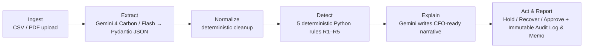

# LedgerLens

> **The pre-payment neuro-symbolic AI "money-leak auditor" for enterprise Accounts Payable — stopping duplicate payments, contract price drift, PO overbilling, FX/tax errors, and cancelled-service charges before disbursement.**

Enterprises silently lose ~2% of outbound spend ($5B across $240B audited) to Accounts Payable leakage—fuzzy duplicate invoices, contract price drift, PO overbilling, FX/tax errors, and cancelled-service charges—because manual 3-way matching cannot scale, exact-match ERPs miss 61% of duplicates, and black-box AI alerts lack the verifiable proof finance teams require before blocking payment.

**Core principle:** Gemini extracts and explains; deterministic Python rules decide; every finding carries a verifiable line-level proof trail. **The LLM is never the judge.**

**Built for the Google DeepMind & Google Cloud Startup Buildathon India 2026** — powered by Gemini 4 Carbon & deterministic Python rules, ready for Google Cloud Run.

---

## Why this exists

| Structural Failure Mode | Quantified Reality | Why Existing Tools Fail |
| :--- | :--- | :--- |
| **1. Exact-Match ERP Blind Spots** | **$5B** in errors across **$240B** enterprise payment volume; **~50%** duplicate payments, **~20%** data-entry errors, **~20%** currency mismatches. | **61%** of double-paid invoices carry non-identical invoice numbers (`INV-8821` vs. `INV-8821-R2`), altered dates, or vendor-name variants—bypassing rigid ERP duplicate checks. |
| **2. The Black-Box AI Trust Deficit** | Finance & AP controllers cannot freeze vendor payouts on an opaque anomaly score. | Generic LLM wrappers flag *"this looks suspicious"* without deterministic math or line-level citations, causing teams to ignore alerts. |
| **3. The Post-Payment Recovery Trap** | Traditional AP recovery audits surface leakage months after disbursement. | Once funds leave the bank, clawbacks cost time, vendor goodwill, and recovery fees—leakage must be stopped **pre-payment** with an audit-ready proof trail. |

## What we are building

Exactly **five** deterministic checks (`R1`–`R5`) backed by structured `proof_trail` math and immutable workflow logging:

| # | Check | What it catches | Rule ID |
|---|-------|-----------------|---------|
| 1 | Duplicate & near-duplicate invoices | Resubmitted invoices with altered invoice numbers, dates, vendor variants, or same-PO/item double billing | `R1` |
| 2 | Contract price leakage | Invoiced unit prices above negotiated contract rates or missed agreed discounts | `R2` |
| 3 | PO mismatch & overbilling | Cumulative billed quantities above PO limits, premature billing before delivery, or uncontracted PO items | `R3` |
| 4 | Currency & tax errors | Currency mismatches vs PO/contract/vendor, FX rate deviations, invalid tax vs contract exemptions, duplicate tax lines | `R4` |
| 5 | Cancelled-service leakage | Recurring charges against cancelled/terminated/expired contracts, inactive vendors, or cancelled POs | `R5` |

### The pipeline



## Architecture (one line)

> **Gemini extracts and explains. The rules engine decides. The workflow logs.**

| Layer | Choice (MVP) | Production path |
|-------|--------------|-----------------|
| Backend | Python 3.11+ · FastAPI · Pydantic | Google Cloud Run |
| Detection engine | Pure deterministic Python rules (`R1`–`R5`) | Same (zero LLM calls inside `detect/`) |
| AI | `GEMINI_PRIMARY_MODEL=gemini-4-carbon` (extract + explain) · `GEMINI_FLASH_MODEL=gemini-2.5-flash` (batch routing) · Agent Skills function calling | Vertex AI + Secret Manager |
| Database | SQLite (`backend/schema.sql`) | Cloud SQL |
| Frontend | React 19 + Vite 6 + Tailwind CSS 3.4 | Cloud Run (unified container) / Firebase Hosting |
| Files | Local `uploads/` | Google Cloud Storage |

## Repository layout

```text
LedgerLens-project/
├── AGENTS.md               ← Harness & neuro-symbolic engineering invariants
├── README.md               ← Project overview & setup
├── Dockerfile              ← Multi-stage Cloud Run container (frontend + FastAPI)
├── cloudbuild.yaml         ← Google Cloud Build + Cloud Run CI/CD pipeline
├── deploy/cloudrun.sh      ← One-command Cloud Run / GCS / Cloud SQL deploy script
├── docs/                   ← Team specs (01–07), DEMO_RUNBOOK.md & ai_studio_schemas/
├── backend/                ← FastAPI app, extraction, normalization, R1–R5 rules, skills & tests
│   ├── app/
│   │   ├── main.py         (API routes + Cloud Run SPA static mount)
│   │   ├── ingest/         (CSV/PDF upload validation & storage)
│   │   ├── extract/        (Gemini 4 Carbon / Flash structured output + math checks)
│   │   ├── normalize/      (deterministic vendor, invoice #, date, currency cleanup)
│   │   ├── detect/         (pure deterministic R1–R5 rules + proof_trail)
│   │   ├── explain/        (Gemini CFO-ready narrative grounded in proof_trail)
│   │   └── skills/         (Google Agent Skills: fetch_payment_records, generate_audit_memo, route_recovery_task)
│   ├── schema.sql
│   ├── requirements.txt
│   └── tests/
├── frontend/               ← React 19 forensic dashboard + Split-View Proof Trail Inspector
└── sample_data/            ← Demo dataset with 6 planted anomalies (₹40,531.60) + 4 clean controls
```

## Quickstart

**Backend** (Python 3.11+):

```bash
cd backend
python -m venv .venv
.venv\Scripts\activate            # Windows  (macOS/Linux: source .venv/bin/activate)
pip install -r requirements.txt
copy .env.example .env            # optionally set GEMINI_API_KEY; offline fallback works without a key
uvicorn app.main:app --reload
# -> http://127.0.0.1:8000/docs
```

**Frontend** (Node 20+):

```bash
cd frontend
npm install
npm run dev
# -> http://localhost:5173
```

## Sample data

`sample_data/` contains a coherent demo dataset with **six planted anomalies** (`₹40,531.60` nominal total exposure across R1–R5) plus **four clean control invoices** that produce **zero** findings. Load it in one click (`Load Demo Dataset`) or run `pytest` in `backend/`.

## Buildathon deliverables checklist

- [x] Upload invoices, POs, contracts, payment ledger (CSV/PDF) + `POST /api/run/{batch_id}/extract`
- [x] Gemini structured-output extraction (`gemini-4-carbon` / `gemini-2.5-flash`) + offline fallback & math verification
- [x] Deterministic checks (`R1`–`R5`) with zero LLM calls and line-level `proof_trail`
- [x] Exception dashboard with Split-View Proof Trail Inspector & 3-way evidence diff
- [x] Reviewer approve / reject / recovery workflow with immutable audit log
- [x] One-click **CFO Audit Memo** (Markdown download + JSON summary)
- [x] Cloud Run deployment readiness (`Dockerfile`, `cloudbuild.yaml`, `deploy/cloudrun.sh`) & 3-minute demo runbook

## Non-goals (do NOT build these)

- A full ERP, payment rails, or autonomous payments.
- Black-box fraud scores without deterministic evidence.
- Legacy ERP connectors (SAP/Oracle/NetSuite) — CSV/PDF upload + Agent Skills covers the MVP and production path.
