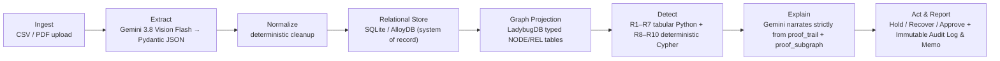

# LedgerLens

<p align="left">
  
  
  
  
  
  
  
</p>
<p align="left">
  
  
  
  
  
</p>

> **The pre-payment neuro-symbolic AI "money-leak auditor" for mid-market finance teams ($20M–$500M annual supplier spend) and CA / audit firms — gating every weekly pay run to stop duplicate payments, contract price drift, PO overbilling, FX/tax errors, and cancelled-service charges before disbursement.**

Mid-market finance teams lose 0.1%–0.35% of annual supplier spend to near-duplicate invoices, contract overcharges, and cancelled-service renewals before every pay run—because manual AP checks can't scale, exact-match ERPs miss fuzzy errors, and CFOs won't act on black-box AI alerts without an audit-ready proof trail.

**Core principle:** Gemini extracts and explains; deterministic Python rules **and deterministic Cypher over the embedded LadybugDB knowledge graph** decide; every finding carries a verifiable line-level proof trail (plus a serialized multi-hop `proof_subgraph` for the graph rules R8–R10). **The LLM is never the judge.**

---

## Why this exists

- **Target ICP:** Mid-market finance teams ($20M–$500M annual supplier spend) and CA / audit firms who export CSVs/PDFs today without heavy ERP integrations.
- **Workflow Moment:** Primary pre-payment gate before every weekly pay run, paired with a **48-hour Historical Leak Diagnostic** (post-payment recovery) as the zero-ERP onboarding wedge.

| Structural Failure Mode | Quantified Reality | Why Existing Tools Fail |
| :--- | :--- | :--- |
| **1. Exact-Match ERP Blind Spots & Manual Cost** | Manual invoice processing averages **~$10 and 10+ days** per invoice (PRGX). | Non-identical invoice numbers (`INV-8821` vs. `INV-8821-R2`), altered dates, and vendor-name variants bypass rigid exact-match ERP duplicate checks, while contract drift slips past manual reviews. |
| **2. The Black-Box AI Trust Deficit** | CFOs and AP controllers will not freeze vendor payouts on an opaque anomaly score. | Generic LLM wrappers flag *"this looks suspicious"* without deterministic math or line-level citations, causing finance teams to ignore alerts. |
| **3. Post-Payment Recovery vs. Pre-Payment Controls** | Post-payment recovery reclaims **~0.1% of spend** (**~$1M recovered per $1B spend** — PRGX); proactive pre-payment controls save **0.2%–0.35% per $1B spend** (Xelix / Duplo). | Once funds leave the bank, clawbacks cost time, vendor goodwill, and recovery fees—leakage must be stopped **pre-payment** before every weekly pay run with an audit-ready proof trail. |

## What we are building

Exactly **ten** deterministic checks (`R1`–`R10`) backed by structured `proof_trail` math, serialized `proof_subgraph` evidence, and immutable workflow logging:

| # | Check | What it catches | Rule ID |
|---|-------|-----------------|---------|
| 1 | Duplicate & near-duplicate invoices | Resubmitted invoices with altered invoice numbers, dates, vendor variants, or same-PO/item double billing | `R1` |
| 2 | Contract price leakage | Invoiced unit prices above negotiated contract rates or missed agreed discounts | `R2` |
| 3 | PO mismatch & overbilling | Cumulative billed quantities above PO limits, premature billing before delivery, or uncontracted PO items | `R3` |
| 4 | Currency & tax errors | Currency mismatches vs PO/contract/vendor, FX rate deviations, invalid tax vs contract exemptions, duplicate tax lines | `R4` |
| 5 | Cancelled-service leakage | Recurring charges against cancelled/terminated/expired contracts, inactive vendors, or cancelled POs | `R5` |
| 6 | Split-PO / approval-limit bypass | The same PO billed across consecutive invoices to dodge per-invoice duplicate checks | `R6` |
| 7 | 3-way GRN mismatch | Invoices billing more quantity than the goods-receipt note accepted | `R7` |
| 8 | Cross-entity duplicate & threshold-splitting *(graph)* | Two **distinct vendors** sharing a bank account / tax identifier billing near-identical or split invoices — invisible to vendor-grouped tabular checks | `R8` |
| 9 | Approver–vendor collusion *(graph)* | An approver linked to their vendor via shared bank account, registered address, or phone — conflict of interest | `R9` |
| 10 | Contract lineage & unapplied credits *(graph)* | Invoices billed at superseded amendment rates (ERP master-data lag) + OPEN supplier credit notes left on the table | `R10` |

`R1`–`R7` are pure tabular Python. `R8`–`R10` match multi-hop structural patterns with **100% deterministic Cypher** in the embedded LadybugDB graph, then re-verify every amount in pure Python. No LLM ever produces a number.

### The pipeline



## Business Model & GTM

LedgerLens targets the global AP automation market (**$6.94B in 2026 → $12.46B by 2031 at 12.44% CAGR**, Mordor Intelligence; **$2.99B software-only in 2025**, DataM Intelligence) using a **Hybrid Wedge → SaaS** model:

1. **Land — 48-Hour "Historical Leak Diagnostic":** Free diagnostic or **15%–20% contingency** on 6–12 months of exported CSVs/PDFs (zero ERP integration required), proving **$50k–$250k** in historical leaks and near-miss exposures.
2. **Expand — Recurring Pre-Payment SaaS:** Embedded as the primary pre-payment gate before every weekly pay run across **Starter** (`<=2,500` invoices/mo), **Growth** (`<=10,000` invoices/mo), and **Enterprise** (custom) tiers—delivering **85%–92%+ gross margins** using **Gemini 3.8 Vision Flash** plus zero-cost deterministic Python rules (`R1`–`R5`).
3. **Distribute — CA / Audit Firms:** Multi-tenant workspace priced per client audit, turning CA and audit firms into a scalable channel for mid-market adoption.

## Architecture (one line)

> **Gemini extracts and explains. The rules engine decides. The workflow logs.**

| Layer | Choice (MVP / Local) | Production GCP path |
|-------|----------------------|---------------------|
| Backend | Python 3.11+ · FastAPI · Pydantic | Google Cloud Run (`deploy/cloudrun.sh`) |
| Detection engine | Pure deterministic Python rules (`R1`–`R7`) + deterministic Cypher rules (`R8`–`R10`) | Same (zero LLM calls inside `detect/`) |
| Knowledge Graph | **LadybugDB** embedded in-process (`.lbdb` file / `:memory:`), 11 node + 15 relationship tables, deterministic rebuild projection | Same single container — no external graph server, Cloud Run compatible |
| AI | `GEMINI_PRIMARY_MODEL=gemini-3.8-vision-flash` · `GEMINI_FLASH_MODEL=gemini-3.8-vision-flash` (Gemini 3.8 Vision Flash) · offline deterministic fallback | Vertex AI (`USE_VERTEX_AI=true`) + Secret Manager (`GEMINI_API_KEY`) |
| Operational DB | SQLite (`backend/schema.sql`) | AlloyDB for PostgreSQL (`backend/schema_postgres.sql`, `DB_BACKEND=alloydb`) |
| Analytics Warehouse | FX-normalized INR summary (`/api/analytics/executive`) | BigQuery (`infra/bigquery/schema.sql`, `POST /api/gcp/bigquery/sync`) |
| Evidence Storage & Events | Local `uploads/` + SHA-256 hashing + in-process log | Cloud Storage (`GCS_UPLOAD_BUCKET`) + Cloud Pub/Sub (`PUBSUB_RECOVERY_TOPIC`) |
| Frontend | Minimalist Finance Controller UI (React 19 + Vite 6 + Tailwind CSS 3.4) | Cloud Run (unified container) / Firebase Hosting |

## Minimalist Finance UI

The React frontend is organized as a high-trust controller workbench with four focused surfaces:

- **Exceptions:** 4-metric executive INR strip + **Knowledge Graph KPI strip** (entities / links / multi-hop risks with one-click deterministic rebuild), single-row filters, inline bulk triage (`POST /api/findings/bulk-decision`), and a Split-View **Proof Trail Inspector** with 3-way Invoice / Contract / PO comparison, an interactive **Proof Graph** canvas (layered SVG evidence subgraph — pan/zoom, click-to-inspect, amber risk edges), one-click **Copy Dispute Email** (`GET /api/findings/{id}/dispute-packet`), and collapsible proof math.
- **Activity:** Batch ingestion tracker and immutable decision/extraction audit log (`GET /api/audit-log`).
- **Rules & Graph:** Full documentation of the deterministic engine — R1–R7 tabular logic and R8–R10 Cypher logic with their planted-anomaly verification amounts.
- **Cloud & Policy:** Live GCP readiness cards (`GET /api/gcp/status`), BigQuery sync (`POST /api/gcp/bigquery/sync`), top vendors by INR exposure, RFC-4180 CSV export (`GET /api/export/findings.csv`), and deterministic rule policy thresholds (`GET/PUT /api/policy`).

## Embedded Knowledge Graph (LadybugDB)

An in-process, rebuildable **Financial Entity Knowledge Graph** synced from the relational system of record — bank accounts, tax identifiers, addresses, approvers, contracts (with `AMENDS` lineage), invoices, payments, and credit notes as typed nodes/edges (11 node tables, 15 relationship tables).

- **Why a graph:** cross-entity fraud patterns (sister vendors sharing a bank account, approvers sharing an address with their vendor, superseded contract-amendment chains) are single shared nodes / short traversals in a graph — and invisible to tabular per-table rules.
- **Deterministic:** projection is a full rebuild (`DETACH DELETE` → re-insert) so double projection produces identical counts; graph rules R8–R10 run **100% deterministic Cypher** + pure-Python math. `detect/` still imports zero graph/LLM/network modules — the Cypher evidence is pre-fetched in `services.py` and handed to the rules as plain dicts.
- **API:** `POST /api/graph/rebuild`, `GET /api/graph/stats`, `GET /api/graph/findings/{id}/subgraph` (stored subgraphs for R8–R10, derived neighborhoods for R1–R7), `GET /api/graph/entity/{type}/{id}?hops=1..3`, plus the read-only `inspect_entity_graph` Agent Skill.
- **Config:** `LEDGERLENS_GRAPH_ENABLED` (default off in code so every pre-existing suite is untouched; `true` in `.env.example` / production), `LEDGERLENS_GRAPH_PATH` (`:memory:` under pytest), `LEDGERLENS_GRAPH_BUFFER_POOL_MB=256`.
- **Native library:** `python backend/scripts/setup_lbug_native.py` downloads the pinned release binary into the gitignored `.cache/lbug-prebuilt/lib` (HTTPS + host-allowlist + zip-slip guarded). The Dockerfile fetches the Linux build directly.

## GCP Configuration & Integration

Set `backend/.env` (see [backend/.env.example](backend/.env.example)) or Cloud Run environment variables. All GCP services degrade cleanly to local SQLite/filesystem fallbacks when unset.

| Env Variable | Default / Example | Purpose |
|---|---|---|
| `GCP_PROJECT_ID` | *(empty locally)* | Google Cloud project ID for Vertex AI, BigQuery, GCS, and Pub/Sub |
| `GCP_LOCATION` | `asia-south1` (or `global` for Vertex preview) | Primary GCP region / Vertex AI endpoint location |
| `DB_BACKEND` | `sqlite` \| `alloydb` | Database backend (`sqlite` locally, `alloydb` for AlloyDB for PostgreSQL) |
| `ALLOYDB_INSTANCE_URI` | `projects/.../instances/ledgerlens-primary` | Target AlloyDB instance URI when `DB_BACKEND=alloydb` |
| `BQ_DATASET` | `ledgerlens_analytics` | BigQuery dataset for `audited_invoices`, `audit_findings`, and `audit_log_events` |
| `GCS_UPLOAD_BUCKET` | `${PROJECT_ID}-ledgerlens-uploads` | Cloud Storage bucket for SHA-256 verified evidence uploads |
| `USE_VERTEX_AI` | `false` (locally) \| `true` (Cloud Run) | Route Gemini extraction & explanation through Vertex AI IAM |
| `PUBSUB_RECOVERY_TOPIC` | `ledgerlens-recovery-events` | Pub/Sub topic for `recovery` / `rejected` finding decisions |

See **[docs/GCP_INTEGRATION_GUIDE.md](docs/GCP_INTEGRATION_GUIDE.md)** for billing safety alerts, AlloyDB cost warnings, IAM setup, `deploy/setup_gcp.sh`, and `deploy/teardown_gcp.sh`.

## Repository layout

```text
LedgerLens-project/
├── AGENTS.md               ← Harness & neuro-symbolic engineering invariants
├── README.md               ← Project overview & setup
├── Dockerfile              ← Multi-stage Cloud Run container (frontend + FastAPI)
├── cloudbuild.yaml         ← Google Cloud Build + Cloud Run CI/CD pipeline
├── deploy/
│   ├── cloudrun.sh         ← One-command Cloud Run deploy script
│   ├── setup_gcp.sh        ← Idempotent GCP APIs, BigQuery, GCS, Pub/Sub & optional AlloyDB setup
│   └── teardown_gcp.sh     ← Cost-safe teardown script
├── infra/bigquery/schema.sql ← BigQuery tables & executive ROI views
├── docs/                   ← Specs (01–07), PRD.md, CONTEXT_LOG.md, AGENT_PR_WORKFLOW.md, GCP_INTEGRATION_GUIDE.md, DEMO_RUNBOOK.md
├── backend/                ← FastAPI app, extraction, normalization, R1–R5 rules, GCP & finance workflows
│   ├── app/
│   │   ├── main.py         (API routes + Cloud Run SPA static mount)
│   │   ├── ingest/         (CSV/PDF upload validation & storage)
│   │   ├── extract/        (Gemini 3.8 Vision Flash structured output + math checks)
│   │   ├── normalize/      (deterministic vendor, invoice #, date, currency cleanup)
│   │   ├── detect/         (pure deterministic R1–R5 rules + proof_trail)
│   │   ├── explain/        (Gemini CFO-ready narrative grounded in proof_trail)
│   │   ├── gcp/            (Vertex AI, AlloyDB, BigQuery, GCS, Pub/Sub, Secret Manager helpers)
│   │   ├── finance/        (dispute packets, policy thresholds, bulk triage, CSV export)
│   │   ├── graph/          (LadybugDB client, typed schema, projector, Cypher queries, subgraph serializer)
│   │   └── skills/         (Google Agent Skills: fetch_payment_records, generate_audit_memo, route_recovery_task, inspect_entity_graph)
│   ├── scripts/            (setup_lbug_native.py — downloads the pinned native graph library)
│   ├── schema.sql
│   ├── schema_postgres.sql
│   ├── requirements.txt
│   └── tests/
├── frontend/               ← Minimalist Finance UI (Exceptions + Proof Graph, Activity, Rules & Graph, Cloud & Policy)
└── sample_data/            ← Demo dataset: 6 tabular anomalies (₹40,531.60) + 3 graph anomalies (R8–R10) + 4 clean controls
```

## Quickstart

**Backend** (Python 3.11+):

```bash
cd backend
python -m venv .venv
.venv\Scripts\activate            # Windows  (macOS/Linux: source .venv/bin/activate)
pip install -r requirements.txt
python scripts\setup_lbug_native.py   # one-time: download the pinned native LadybugDB library (gitignored)
copy .env.example .env            # set GEMINI_API_KEY (optional); LEDGERLENS_GRAPH_ENABLED=true activates R8–R10
uvicorn app.main:app --reload
# -> http://127.0.0.1:8000/docs
```

> The embedded knowledge graph runs in-process — **no Neo4j, no Docker sidecar, no external graph server**. Cloud Run stays a single container; the Dockerfile downloads the Linux native library at build time and `app/graph/projector.py` deterministically rebuilds the projection from the relational DB on cold start.

**Frontend** (Node 20+):

```bash
cd frontend
npm install
npm run dev
# -> http://localhost:5173
```

## Sample data

`sample_data/` contains a coherent demo dataset with **six planted tabular anomalies** (`₹40,531.60` across R1–R5), **three planted graph anomalies** (R8–R10: ₹22,444.00) and **four clean control invoices** that produce **zero** findings in both modes. Tabular-only detection yields the original 6 findings / ₹40,531.60; enabling the graph layer yields **10 findings / ₹62,975.60** — the tabular results never change. Load it in one click (`Load Demo Dataset`) or run `pytest` in `backend/`.

## Documentation Index

| Document | Focus | Link |
|---|---|---|
| **Product Requirements (PRD)** | Executive summary, neuro-symbolic invariants, MVP vs V1 roadmap | [docs/PRD.md](docs/PRD.md) |
| **Session Context Log** | Session context log for multi-session & multi-agent continuity | [docs/CONTEXT_LOG.md](docs/CONTEXT_LOG.md) |
| **AI Harness & PR Workflow** | Mandatory branching & PR rules for ZCode (`GLM 5.3`), Antigravity (`Gemini`), etc. | [docs/AGENT_PR_WORKFLOW.md](docs/AGENT_PR_WORKFLOW.md) |
| **GCP Integration & Billing Guide** | BigQuery, AlloyDB, GCS, Vertex AI, Pub/Sub setup & cost guardrails | [docs/GCP_INTEGRATION_GUIDE.md](docs/GCP_INTEGRATION_GUIDE.md) |
| **3-Minute Demo Runbook** | Live demo script, sample data walkthrough & Cloud Run deployment | [docs/DEMO_RUNBOOK.md](docs/DEMO_RUNBOOK.md) |
| **Technical Specs (`01`–`07`)** | Product, architecture, schema, R1–R5 rules, APIs, Gemini & UI specs | [docs/](docs/) |

## Buildathon deliverables checklist

- [x] Upload invoices, POs, contracts, payment ledger (CSV/PDF) + `POST /api/run/{batch_id}/extract`
- [x] Gemini structured-output extraction (`gemini-3.8-vision-flash`) + offline fallback & math verification
- [x] Deterministic checks (`R1`–`R5`) with zero LLM calls and line-level `proof_trail`
- [x] **Embedded LadybugDB financial knowledge graph** — typed schema, deterministic projector, `/api/graph/*`, and deterministic multi-hop rules `R8`–`R10` with serialized `proof_subgraph` evidence
- [x] Exception dashboard with Split-View Proof Trail Inspector & 3-way evidence diff + interactive **Proof Graph** canvas
- [x] Reviewer approve / reject / recovery workflow with immutable audit log
- [x] One-click **CFO Audit Memo** (Markdown download + JSON summary)
- [x] Cloud Run deployment readiness (`Dockerfile`, `cloudbuild.yaml`, `deploy/cloudrun.sh`) & 3-minute demo runbook

## Pre-Requisite: AI Harness & Branch Protection Workflow

`main` is protected by the GitHub **`Protect main`** repository ruleset (direct pushes, force-pushes, and branch deletions are blocked; Pull Requests are required).

Before making or pushing changes, **all AI coding harnesses and their models** — including **ZCode (`GLM 5.3`)**, **Antigravity (`Gemini`)**, **Claude Code**, **Codex**, and **Cursor** — MUST follow **[docs/AGENT_PR_WORKFLOW.md](docs/AGENT_PR_WORKFLOW.md)** and **[AGENTS.md](AGENTS.md)**:

1. **Never** commit, push, or merge directly into `main`.
2. Branch from `origin/main` using `feat/<slug>`, `fix/<slug>`, `docs/<slug>`, or `chore/<slug>`.
3. Run pre-PR checks (`pytest` + `npm --prefix frontend run build`) before pushing.
4. Push only to your feature/docs branch (`git push -u origin <branch>`) and open a **Pull Request to `main`** for the repository owner to merge.

## Non-goals (do NOT build these)

- A full ERP, payment rails, or autonomous payments.
- Black-box fraud scores without deterministic evidence.
- Legacy ERP connectors (SAP/Oracle/NetSuite) — CSV/PDF upload + Agent Skills covers the MVP and production path.
