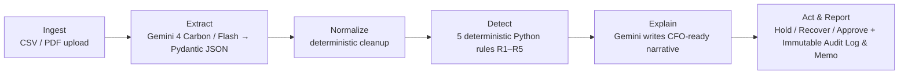

# LedgerLens

> **The pre-payment neuro-symbolic AI "money-leak auditor" for enterprise Accounts Payable — stopping duplicate payments, contract price drift, PO overbilling, FX/tax errors, and cancelled-service charges before disbursement.**

Enterprises silently lose ~2% of outbound spend ($5B across $240B audited) to Accounts Payable leakage—fuzzy duplicate invoices, contract price drift, PO overbilling, FX/tax errors, and cancelled-service charges—because manual 3-way matching cannot scale, exact-match ERPs miss 61% of duplicates, and black-box AI alerts lack the verifiable proof finance teams require before blocking payment.

**Core principle:** Gemini extracts and explains; deterministic Python rules decide; every finding carries a verifiable line-level proof trail. **The LLM is never the judge.**

**Built for the Google DeepMind & Google Cloud Startup Buildathon India 2026** — powered by Gemini 4 Carbon & deterministic Python rules, ready for Google Cloud Run.

---

## Why this exists

| Structural Failure Mode | Quantified Reality | Why Existing Tools Fail |
| :--- | :--- | :--- |
| **1. Exact-Match ERP Blind Spots** | **$5B** in errors across **$240B** enterprise payment volume; **~50%** duplicate payments, **~20%** data-entry errors, **~20%** currency mismatches. | **61%** of double-paid invoices carry non-identical invoice numbers (`INV-8821` vs. `INV-8821-R2`), altered dates, or vendor-name variants—bypassing rigid ERP duplicate checks. |
| **2. The Black-Box AI Trust Deficit** | Finance & AP controllers cannot freeze vendor payouts on an opaque anomaly score. | Generic LLM wrappers flag *"this looks suspicious"* without deterministic math or line-level citations, causing teams to ignore alerts. |
| **3. The Post-Payment Recovery Trap** | Traditional AP recovery audits surface leakage months after disbursement. | Once funds leave the bank, clawbacks cost time, vendor goodwill, and recovery fees—leakage must be stopped **pre-payment** with an audit-ready proof trail. |

## What we are building

Exactly **five** deterministic checks (`R1`–`R5`) backed by structured `proof_trail` math and immutable workflow logging:

| # | Check | What it catches | Rule ID |
|---|-------|-----------------|---------|
| 1 | Duplicate & near-duplicate invoices | Resubmitted invoices with altered invoice numbers, dates, vendor variants, or same-PO/item double billing | `R1` |
| 2 | Contract price leakage | Invoiced unit prices above negotiated contract rates or missed agreed discounts | `R2` |
| 3 | PO mismatch & overbilling | Cumulative billed quantities above PO limits, premature billing before delivery, or uncontracted PO items | `R3` |
| 4 | Currency & tax errors | Currency mismatches vs PO/contract/vendor, FX rate deviations, invalid tax vs contract exemptions, duplicate tax lines | `R4` |
| 5 | Cancelled-service leakage | Recurring charges against cancelled/terminated/expired contracts, inactive vendors, or cancelled POs | `R5` |

### The pipeline



## Architecture (one line)

> **Gemini extracts and explains. The rules engine decides. The workflow logs.**

| Layer | Choice (MVP / Local) | Production GCP path |
|-------|----------------------|---------------------|
| Backend | Python 3.11+ · FastAPI · Pydantic | Google Cloud Run (`deploy/cloudrun.sh`) |
| Detection engine | Pure deterministic Python rules (`R1`–`R5`) | Same (zero LLM calls inside `detect/`) |
| AI | `GEMINI_PRIMARY_MODEL=gemini-4-carbon` · `GEMINI_FLASH_MODEL=gemini-2.5-flash` · offline deterministic fallback | Vertex AI (`USE_VERTEX_AI=true`) + Secret Manager (`GEMINI_API_KEY`) |
| Operational DB | SQLite (`backend/schema.sql`) | AlloyDB for PostgreSQL (`backend/schema_postgres.sql`, `DB_BACKEND=alloydb`) |
| Analytics Warehouse | FX-normalized INR summary (`/api/analytics/executive`) | BigQuery (`infra/bigquery/schema.sql`, `POST /api/gcp/bigquery/sync`) |
| Evidence Storage & Events | Local `uploads/` + SHA-256 hashing + in-process log | Cloud Storage (`GCS_UPLOAD_BUCKET`) + Cloud Pub/Sub (`PUBSUB_RECOVERY_TOPIC`) |
| Frontend | Minimalist Finance Controller UI (React 19 + Vite 6 + Tailwind CSS 3.4) | Cloud Run (unified container) / Firebase Hosting |

## Minimalist Finance UI

The React frontend is organized as a high-trust controller workbench with three focused surfaces:

- **Exceptions:** 4-metric executive INR strip, single-row filters, inline bulk triage (`POST /api/findings/bulk-decision`), and a Split-View **Proof Trail Inspector** with 3-way Invoice / Contract / PO comparison, one-click **Copy Dispute Email** (`GET /api/findings/{id}/dispute-packet`), and collapsible proof math.
- **Activity:** Batch ingestion tracker and immutable decision/extraction audit log (`GET /api/audit-log`).
- **Cloud & Policy:** Live GCP readiness cards (`GET /api/gcp/status`), BigQuery sync (`POST /api/gcp/bigquery/sync`), top vendors by INR exposure, RFC-4180 CSV export (`GET /api/export/findings.csv`), and deterministic rule policy thresholds (`GET/PUT /api/policy`).

## GCP Configuration & Integration

Set `backend/.env` (see [backend/.env.example](backend/.env.example)) or Cloud Run environment variables. All GCP services degrade cleanly to local SQLite/filesystem fallbacks when unset.

| Env Variable | Default / Example | Purpose |
|---|---|---|
| `GCP_PROJECT_ID` | *(empty locally)* | Google Cloud project ID for Vertex AI, BigQuery, GCS, and Pub/Sub |
| `GCP_LOCATION` | `asia-south1` (or `global` for Vertex preview) | Primary GCP region / Vertex AI endpoint location |
| `DB_BACKEND` | `sqlite` \| `alloydb` | Database backend (`sqlite` locally, `alloydb` for AlloyDB for PostgreSQL) |
| `ALLOYDB_INSTANCE_URI` | `projects/.../instances/ledgerlens-primary` | Target AlloyDB instance URI when `DB_BACKEND=alloydb` |
| `BQ_DATASET` | `ledgerlens_analytics` | BigQuery dataset for `audited_invoices`, `audit_findings`, and `audit_log_events` |
| `GCS_UPLOAD_BUCKET` | `${PROJECT_ID}-ledgerlens-uploads` | Cloud Storage bucket for SHA-256 verified evidence uploads |
| `USE_VERTEX_AI` | `false` (locally) \| `true` (Cloud Run) | Route Gemini extraction & explanation through Vertex AI IAM |
| `PUBSUB_RECOVERY_TOPIC` | `ledgerlens-recovery-events` | Pub/Sub topic for `recovery` / `rejected` finding decisions |

See **[docs/GCP_INTEGRATION_GUIDE.md](docs/GCP_INTEGRATION_GUIDE.md)** for billing safety alerts, AlloyDB cost warnings, IAM setup, `deploy/setup_gcp.sh`, and `deploy/teardown_gcp.sh`.

## Repository layout

```text
LedgerLens-project/
├── AGENTS.md               ← Harness & neuro-symbolic engineering invariants
├── README.md               ← Project overview & setup
├── Dockerfile              ← Multi-stage Cloud Run container (frontend + FastAPI)
├── cloudbuild.yaml         ← Google Cloud Build + Cloud Run CI/CD pipeline
├── deploy/
│   ├── cloudrun.sh         ← One-command Cloud Run deploy script
│   ├── setup_gcp.sh        ← Idempotent GCP APIs, BigQuery, GCS, Pub/Sub & optional AlloyDB setup
│   └── teardown_gcp.sh     ← Cost-safe teardown script
├── infra/bigquery/schema.sql ← BigQuery tables & executive ROI views
├── docs/                   ← Specs (01–07), PRD.md, AGENT_PR_WORKFLOW.md, GCP_INTEGRATION_GUIDE.md, DEMO_RUNBOOK.md
├── backend/                ← FastAPI app, extraction, normalization, R1–R5 rules, GCP & finance workflows
│   ├── app/
│   │   ├── main.py         (API routes + Cloud Run SPA static mount)
│   │   ├── ingest/         (CSV/PDF upload validation & storage)
│   │   ├── extract/        (Gemini 4 Carbon / Flash structured output + math checks)
│   │   ├── normalize/      (deterministic vendor, invoice #, date, currency cleanup)
│   │   ├── detect/         (pure deterministic R1–R5 rules + proof_trail)
│   │   ├── explain/        (Gemini CFO-ready narrative grounded in proof_trail)
│   │   ├── gcp/            (Vertex AI, AlloyDB, BigQuery, GCS, Pub/Sub, Secret Manager helpers)
│   │   ├── finance/        (dispute packets, policy thresholds, bulk triage, CSV export)
│   │   └── skills/         (Google Agent Skills: fetch_payment_records, generate_audit_memo, route_recovery_task)
│   ├── schema.sql
│   ├── schema_postgres.sql
│   ├── requirements.txt
│   └── tests/
├── frontend/               ← Minimalist Finance UI (Exceptions, Activity, Cloud & Policy)
└── sample_data/            ← Demo dataset with 6 planted anomalies (₹40,531.60) + 4 clean controls
```

## Quickstart

**Backend** (Python 3.11+):

```bash
cd backend
python -m venv .venv
.venv\Scripts\activate            # Windows  (macOS/Linux: source .venv/bin/activate)
pip install -r requirements.txt
copy .env.example .env            # optionally set GEMINI_API_KEY; offline fallback works without a key
uvicorn app.main:app --reload
# -> http://127.0.0.1:8000/docs
```

**Frontend** (Node 20+):

```bash
cd frontend
npm install
npm run dev
# -> http://localhost:5173
```

## Sample data

`sample_data/` contains a coherent demo dataset with **six planted anomalies** (`₹40,531.60` nominal total exposure across R1–R5) plus **four clean control invoices** that produce **zero** findings. Load it in one click (`Load Demo Dataset`) or run `pytest` in `backend/`.

## Buildathon deliverables checklist

- [x] Upload invoices, POs, contracts, payment ledger (CSV/PDF) + `POST /api/run/{batch_id}/extract`
- [x] Gemini structured-output extraction (`gemini-4-carbon` / `gemini-2.5-flash`) + offline fallback & math verification
- [x] Deterministic checks (`R1`–`R5`) with zero LLM calls and line-level `proof_trail`
- [x] Exception dashboard with Split-View Proof Trail Inspector & 3-way evidence diff
- [x] Reviewer approve / reject / recovery workflow with immutable audit log
- [x] One-click **CFO Audit Memo** (Markdown download + JSON summary)
- [x] Cloud Run deployment readiness (`Dockerfile`, `cloudbuild.yaml`, `deploy/cloudrun.sh`) & 3-minute demo runbook

## Pre-Requisite: AI Harness & Branch Protection Workflow

`main` is protected by the GitHub **`Protect main`** repository ruleset (direct pushes, force-pushes, and branch deletions are blocked; Pull Requests are required).

Before making or pushing changes, **all AI coding harnesses and their models** — including **ZCode (`GLM 5.3`)**, **Antigravity (`Gemini`)**, **Claude Code**, **Codex**, and **Cursor** — MUST follow **[docs/AGENT_PR_WORKFLOW.md](docs/AGENT_PR_WORKFLOW.md)** and **[AGENTS.md](AGENTS.md)**:

1. **Never** commit, push, or merge directly into `main`.
2. Branch from `origin/main` using `feat/<slug>`, `fix/<slug>`, `docs/<slug>`, or `chore/<slug>`.
3. Run pre-PR checks (`pytest` + `npm --prefix frontend run build`) before pushing.
4. Push only to your feature/docs branch (`git push -u origin <branch>`) and open a **Pull Request to `main`** for the repository owner to merge.

## Non-goals (do NOT build these)

- A full ERP, payment rails, or autonomous payments.
- Black-box fraud scores without deterministic evidence.
- Legacy ERP connectors (SAP/Oracle/NetSuite) — CSV/PDF upload + Agent Skills covers the MVP and production path.
