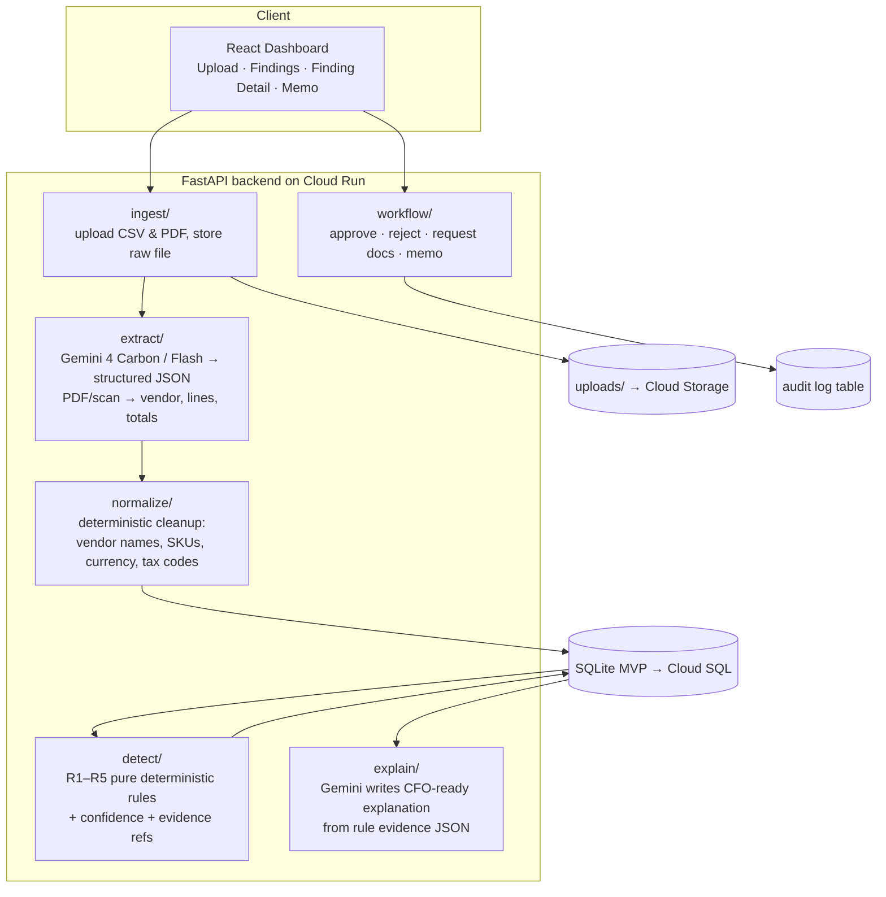

# 02 · Architecture — LedgerLens

## 0. The design principle (memorize this)

> **Gemini extracts and explains. The rules engine decides. The workflow logs.**
> The LLM is never the only source of a finding. Every finding is produced by a deterministic, auditable rule; Gemini turns unstructured documents into structured data before detection, and turns rule output into finance language after detection.

This is what makes LedgerLens **audit-ready** — and it is the architectural answer to every judge who asks "why should a CFO trust this?"

## 1. System diagram

## 2. Stage-by-stage responsibility

| Stage | Module | Responsibility | Primary owner |
|-------|--------|----------------|---------------|
| Ingest | `backend/app/ingest/` | Accept CSV/PDF uploads, store raw file, create batch | Backend lead |
| Extract | `backend/app/extract/` | Gemini structured output → canonical JSON (schema in `extract/schemas.py`) | AI lead |
| Normalize | `backend/app/normalize/` | Vendor-name variants, currency codes, units, tax codes → canonical forms | Data lead |
| Store | `schema.sql` + `db.py` | SQLite tables mirroring `docs/03_DATA_MODEL.md` | Backend lead |
| Detect | `backend/app/detect/` | R1–R5, pure functions: `(context) → [Finding]`. No DB, no network, no Gemini. | Detection owner |
| Explain | `backend/app/explain/` | Finding JSON + evidence → headline, explanation, recommended action, confidence & limitations | AI lead |
| Act | `main.py` routes + `frontend/` | Decisions, recovery tasks, audit memo | Frontend + Backend |

## 3. Journey of one invoice (walkthrough)

1. AP analyst uploads `INV-8821.pdf` → stored in `uploads/`, batch created.
2. **Extract**: Gemini returns JSON conforming to the invoice schema: vendor, invoice number, date, currency, lines `[{item, qty, unit_price, tax_pct, line_total}]`, totals. Stored in `invoices` table with `source_file` link.
3. **Normalize**: `"SUNBEAM ELECTRICALS PVT. LTD."` → `sunbeam electricals`; `"Rs. 4,956.00"` → `4956.00 INR`; tax code `"GST 18%"` → `tax_pct=18`.
4. **Detect**: R1 loads the normalized context, compares against other invoices from the same vendor, finds `INV-8821-R2`, emits a `Finding` with evidence refs to both invoices + both payments, confidence `0.93`, amount at risk `4956.00 INR`.
5. **Explain**: Gemini receives the finding JSON (rule output only — it cannot invent evidence) and writes the plain-English card. Structured output enforces `{headline, explanation, recommended_action, confidence_label, limitations}`.
6. **Act**: reviewer rejects the second payment → row appended to `audit_log` (who, what, when, finding id).

## 4. Tech stack & rationale

| Choice | Why (be ready to defend it) |
|--------|------------------------------|
| FastAPI | Typed, fast, auto OpenAPI docs — the API spec doc practically writes itself |
| SQLite (MVP) | Zero setup, single file; schema written so swapping to Cloud SQL is a config change |
| Gemini 4 Carbon + Flash (`GEMINI_PRIMARY_MODEL` / `GEMINI_FLASH_MODEL`) | Fast + accurate multimodal PDF/scan extraction, native structured output (JSON schema) & Agent Skills function calling |
| React + Vite + Tailwind | Fastest path to a clean dashboard; no framework yak-shaving |
| Pure-python rules | Rules must be unit-testable, deterministic, and citable — no framework lock-in |

## 5. Deployment plan (Google Cloud)

| Component | Service | Notes |
|-----------|---------|-------|
| Backend API | **Cloud Run** | Multi-stage container from root `Dockerfile` (`cloudbuild.yaml`, `deploy/cloudrun.sh`); env vars for `GEMINI_API_KEY` via Secret Manager |
| Frontend | **Cloud Run** (static container) or Firebase Hosting | Static build of the Vite app |
| Database | Cloud SQL (SQLite locally for dev) | Same schema |
| Files | Cloud Storage bucket | Replaces `uploads/` |
| Secrets | Secret Manager | `GEMINI_API_KEY` never in code, never in git |

Demo path if time is short: local demo → single Cloud Run deploy of the backend → frontend talks to it. Record the 90-second demo video from the deployed URL if possible (judges reward "deployed on Google Cloud").

## 6. Security & audit (MVP-honest version)

- `.env` holds the Gemini key locally; on Cloud it lives in Secret Manager. Never in git.
- Every decision writes an immutable `audit_log` row: `{timestamp, user, finding_id, action, note}`.
- Every finding stores the rule that fired and every evidence record ID — the trail is reconstructable without the LLM.
- Uploads are quarantined in `uploads/` (Cloud Storage later) and never served raw to the UI without going through the pipeline.
