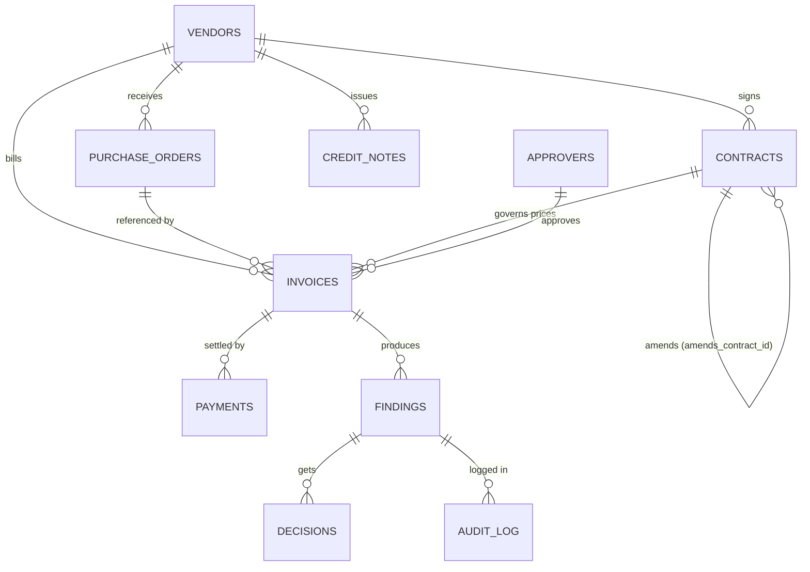

# 03 · Data Model — LedgerLens

Canonical column dictionaries for the MVP. **`sample_data/*.csv`, `backend/schema.sql`, and this document must always agree.** If you change a column, change all three in the same PR.

## 1. Entity overview



### Graph projection (LadybugDB)

SQLite/AlloyDB remains the transactional system of record. `backend/app/graph/projector.py` projects these tables into an embedded LadybugDB property graph (11 node tables, 15 relationship tables — see `backend/app/graph/schema.py`) where shared personal infrastructure (bank accounts, tax identifiers, addresses) and contract amendment lineage become first-class nodes/edges, powering deterministic multi-hop rules R6–R8. New nullable columns: `vendors.bank_account/email/phone/address`, `invoices.approver_id`, `contracts.amends_contract_id/version`, `payments.account_key`. New tables: `approvers`, `credit_notes`.

## 2. Table dictionaries

### vendors
| Column | Type | Meaning |
|--------|------|---------|
| vendor_id | TEXT PK | `V001`, `V002`, … |
| vendor_name | TEXT | Canonical legal name |
| tax_id | TEXT | GSTIN / EIN as printed |
| default_currency | TEXT | ISO 4217 (`INR`, `USD`, …) |
| status | TEXT | `active` / `blocked` |

### contracts
| Column | Type | Meaning |
|--------|------|---------|
| contract_id | TEXT PK | `C-001`, … |
| vendor_id | TEXT FK | → vendors |
| item | TEXT | Product/service the line governs |
| contracted_unit_price | REAL | Negotiated unit price |
| currency | TEXT | ISO 4217 |
| discount_pct | REAL | Agreed discount (0 = none) |
| payment_terms | TEXT | e.g. `Net 30` |
| tax_pct | REAL | Contractual tax rate; `0` where exempt |
| start_date, end_date | TEXT (ISO) | Validity window |
| status | TEXT | `active` / `cancelled` |

### purchase_orders
| Column | Type | Meaning |
|--------|------|---------|
| po_id | TEXT | `PO-1001`, … (repeats per line) |
| po_line | INTEGER | Line number within PO |
| vendor_id | TEXT FK | → vendors |
| item | TEXT | Ordered item |
| quantity | REAL | Ordered quantity |
| unit_price | REAL | Agreed PO unit price |
| currency | TEXT | ISO 4217 |
| order_date | TEXT (ISO) | — |
| expected_delivery | TEXT (ISO) | Billed-before-delivery checks compare against this |
| status | TEXT | `open` / `delivered` / `cancelled` |

### invoices  (one row per invoice **line**)
| Column | Type | Meaning |
|--------|------|---------|
| invoice_number | TEXT | Printed number — the thing fraudsters alter (`INV-8821` vs `INV-8821-R2`) |
| vendor_id | TEXT FK | → vendors |
| invoice_date | TEXT (ISO) | — |
| po_id | TEXT FK | nullable — not every invoice references a PO |
| line_no | INTEGER | Line within the invoice |
| item | TEXT | — |
| quantity | REAL | — |
| unit_price | REAL | — |
| currency | TEXT | ISO 4217 |
| tax_pct | REAL | Tax applied on this line |
| line_total | REAL | `quantity × unit_price × (1 + tax_pct/100)`, 2 dp |
| source_file | TEXT | uploaded file it came from (PDF provenance) |
| status | TEXT | `unpaid` / `paid` / `credited` |

### payments
| Column | Type | Meaning |
|--------|------|---------|
| payment_id | TEXT PK | `PAY-5001`, … |
| invoice_number | TEXT FK | → invoices |
| amount | REAL | Paid amount |
| currency | TEXT | ISO 4217 |
| fx_rate_to_inr | REAL | Rate used at payment time (drives FX-error checks) |
| payment_date | TEXT (ISO) | — |
| status | TEXT | `settled` / `reversed` |

### findings  (written by the detect stage)
| Column | Type | Meaning |
|--------|------|---------|
| finding_id | TEXT PK | `F-0001`, … |
| rule_id | TEXT | `R1` … `R5` (see docs/04) |
| title | TEXT | One line, finance-readable |
| severity | TEXT | `critical` / `high` / `medium` / `low` |
| amount_at_risk | REAL | Overbilled delta, or full duplicate amount |
| currency | TEXT | ISO 4217 |
| status | TEXT | `open` / `approved` / `rejected` / `recovery` |
| entity_refs | TEXT (JSON) | `{"invoice_numbers": [...], "po_id": "...", "contract_id": "...", "payment_ids": [...]}` |
| evidence | TEXT (JSON) | List of `{source, record_id, field, value}` |
| confidence | REAL | 0–1 — from the **rule**, not the LLM |
| explanation | TEXT (JSON) | Gemini output: headline, explanation, recommended_action, limitations |

### decisions & audit_log
| Column | Type |
|--------|------|
| id (autoincrement), finding_id, action (`approve`/`reject`/`request_docs`/`recovery`), reviewer, note, created_at | TEXT/INTEGER as appropriate |

## 3. Gemini extraction schemas (structured output)

The extract stage forces Gemini to conform to these JSON schemas (see `backend/app/extract/schemas.py`).

**Invoice:**
```json
{
  "vendor": {"name": "", "tax_id": ""},
  "invoice": {"number": "", "date": "YYYY-MM-DD", "currency": "ISO-4217",
              "po_reference": "", "payment_terms": ""},
  "lines": [{"item": "", "quantity": 0, "unit_price": 0, "tax_pct": 0, "line_total": 0}],
  "totals": {"subtotal": 0, "tax": 0, "grand_total": 0}
}
```

**Contract:**
```json
{
  "contract": {"id": "", "title": "", "vendor_name": "",
               "start_date": "YYYY-MM-DD", "end_date": "YYYY-MM-DD", "status": "active|cancelled"},
  "lines": [{"item": "", "unit_price": 0, "currency": "", "discount_pct": 0,
             "payment_terms": "", "tax_pct": 0}]
}
```

Rules of engagement: extraction **fails closed** — if a required field is missing, the record is quarantined with a low-confidence flag rather than guessed silently.

## 4. Conventions

- Dates are ISO `YYYY-MM-DD` everywhere; money is 2-dp floats + ISO currency code; never bake a currency symbol into a numeric field.
- IDs are stable text (`V001`, `PO-1001`, `INV-8821`, `PAY-5001`, `F-0001`) — evidence links in the UI cite these.
- `invoice_number` is user-visible and fuzzy-compareable; never treat it as a guaranteed unique key (that is exactly what R1 exploits).
