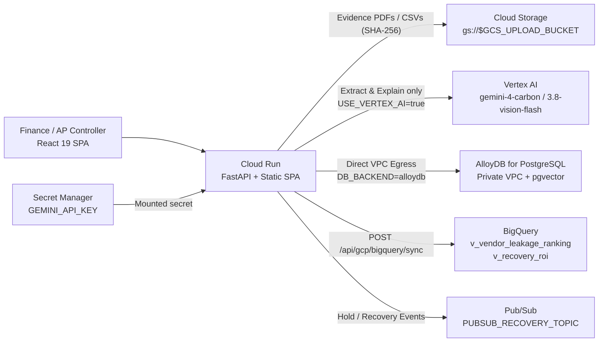

# LedgerLens — Google Cloud Platform (GCP) Integration & Production Guide

**Prepared for:** Vijay (Team Builders — Active GCP Billing Account)  
**Target Stack:** Google Cloud Run · BigQuery · AlloyDB for PostgreSQL · Cloud Storage · Vertex AI (`gemini-4-carbon` / `gemini-3.8-vision-flash`) · Secret Manager · Pub/Sub  
**Primary Region:** `asia-south1` (Mumbai) · **Vertex AI Location:** `global` (or `asia-south1`)

---

## Neuro-Symbolic Architecture on Google Cloud

LedgerLens keeps its core guarantee intact across every deployment target:

> **Gemini extracts and explains. Deterministic Python rules (`R1`–`R5` in `backend/app/detect/`) decide. Immutable logs and cloud analytics audit every rupee.**



| Environment Variable | Default / Example | Purpose |
|---|---|---|
| `DB_BACKEND` | `sqlite` (demo) \| `alloydb` (enterprise) | Selects local SQLite (`backend/schema.sql`) or AlloyDB PostgreSQL (`backend/schema_postgres.sql`) |
| `ALLOYDB_INSTANCE_URI` | `projects/$PROJECT_ID/locations/asia-south1/clusters/ledgerlens-alloydb/instances/ledgerlens-primary` | Target AlloyDB primary instance URI when `DB_BACKEND=alloydb` |
| `GCS_UPLOAD_BUCKET` | `${PROJECT_ID}-ledgerlens-uploads` | Cloud Storage bucket for SHA-256 verified invoice/PO/contract evidence |
| `BQ_DATASET` | `ledgerlens_analytics` | BigQuery dataset populated by `infra/bigquery/schema.sql` and sync |
| `USE_VERTEX_AI` | `true` | Routes extraction and CFO narrative calls through Vertex AI IAM instead of raw API key |
| `GCP_PROJECT_ID` | `$PROJECT_ID` | Google Cloud project ID for Vertex AI, BigQuery, GCS, and Pub/Sub |
| `GCP_LOCATION` | `global` (or `asia-south1`) | Vertex AI endpoint location (regional/global routing for `gemini-4-carbon` and `gemini-3.8-vision-flash`) |
| `GEMINI_PRIMARY_MODEL` | `gemini-4-carbon` | Primary model for multimodal invoice/contract extraction & CFO narrative explanations |
| `GEMINI_FLASH_MODEL` | `gemini-3.8-vision-flash` | High-throughput model for batch/CSV extraction routing |
| `GEMINI_API_KEY` | Secret Manager (`GEMINI_API_KEY:latest`) | Fallback / Google AI Studio key when `USE_VERTEX_AI=false` |
| `PUBSUB_RECOVERY_TOPIC` | `ledgerlens-recovery-alerts` | Pub/Sub topic receiving `HOLD_PAYMENT` / clawback notifications |

---

## 1. Billing Safety & Monthly Cost Breakdown (Read First)

> [!CAUTION]
> **Provision Billing Alerts BEFORE running `deploy/setup_gcp.sh` or creating any AlloyDB instance.** Since your GCP Billing account is already active, setting budget thresholds guarantees zero surprise charges after hackathons or customer demos.

### 1.1 Step 0 — Set \$10 and \$25 GCP Billing Budget Alerts

#### Option A: Google Cloud Console (2 minutes)
1. Open **Billing → Budgets & alerts** in the Google Cloud Console and select your active Billing Account.
2. Click **Create budget**:
   - **Name:** `ledgerlens-demo-guardrail`
   - **Scope:** Select your `LedgerLens` project (`$PROJECT_ID`), all services.
   - **Amount:** **Specified amount → \$25 USD** (and optionally a second budget at **\$10 USD** for early demo monitoring).
   - **Threshold rules:** Set alerts at **40% (\$10)**, **80% (\$20)**, and **100% (\$25)** of actual spend + **100% of forecasted spend**.
   - **Notifications:** Check **Email alerts to billing admins and users** (and optionally connect a Pub/Sub topic for programmatic shutdown alerts).
3. Click **Finish**.

#### Option B: `gcloud` CLI
First find your `BILLING_ACCOUNT_ID`:

```bash
gcloud billing accounts list
```

Then create a \$25 budget with alerts firing at \$10 (40%), \$20 (80%), and \$25 (100%):

```bash
export BILLING_ACCOUNT_ID="012345-6789AB-CDEF01"   # replace with your ID
export PROJECT_ID="ledgerlens-prod"                 # replace with your project ID
export PROJECT_NUMBER=$(gcloud projects describe "$PROJECT_ID" --format="value(projectNumber)")

gcloud billing budgets create \
  --billing-account="$BILLING_ACCOUNT_ID" \
  --display-name="ledgerlens-safety-budget-25usd" \
  --budget-amount=25USD \
  --filter-projects="projects/${PROJECT_NUMBER}" \
  --threshold-rule=percent=0.40 \
  --threshold-rule=percent=0.80 \
  --threshold-rule=percent=1.00 \
  --threshold-rule=percent=1.00,basis=forecasted-spend

# Optional dedicated $10 early-warning budget
gcloud billing budgets create \
  --billing-account="$BILLING_ACCOUNT_ID" \
  --display-name="ledgerlens-early-alert-10usd" \
  --budget-amount=10USD \
  --filter-projects="projects/${PROJECT_NUMBER}" \
  --threshold-rule=percent=0.50 \
  --threshold-rule=percent=1.00
```

### 1.2 Service-by-Service Monthly Cost Breakdown

| GCP Service | Free Tier / Pricing Behavior | Estimated Demo Cost | Notes for LedgerLens |
|---|---|---|---|
| **Cloud Run** | 2M requests, 360k vCPU-sec, 180k GiB-sec free/month; **scales to zero** (`--min-instances=0`) | **\$0 – \$0.50 / mo** | Idle time costs \$0. Unified container (`Dockerfile`) serves FastAPI + React SPA. |
| **BigQuery** | **1 TB query processing/month + 10 GB active storage/month free** | **\$0 / mo** | Demo findings, audit logs, and ROI views are a few MBs—well inside the free tier. |
| **Cloud Storage (GCS)** | ~\$0.02/GB-month (`asia-south1` Standard); minimal Class A/B ops | **\$0.01 – \$0.10 / mo** | SHA-256 invoice PDFs & CSV batches for demos are under 100 MB. |
| **Secret Manager** | **6 active secret versions + 10,000 access ops free/month** | **\$0 / mo** | Storing `GEMINI_API_KEY` uses 1 active version. |
| **Pub/Sub** | **10 GB/month free** ingestion & delivery | **\$0 / mo** | JSON recovery alerts (`HOLD_PAYMENT`, `REQUEST_CREDIT_NOTE`) are a few KB each. |
| **Vertex AI (Gemini 4 Carbon / 3.8 Vision Flash)** | Pay-per-token (1M input/output token pricing; no idle fee) | **\$0.05 – \$1.00 / demo** | `sample_data/` (~15 docs) + explanations cost pennies; deterministic `detect/` uses **0 tokens**. |
| **Cloud SQL for PostgreSQL** *(Alternative)* | Shared-core `db-f1-micro` / `db-g1-small` | **~\$10 – \$25 / mo** | Low-cost managed Postgres when you want relational persistence without AlloyDB's minimum vCPU floor. |
| **AlloyDB for PostgreSQL** *(Enterprise)* | **Dedicated compute (`db-n2-highmem-2` / 2 vCPU, 16 GB RAM minimum); NO scale-to-zero** | **~\$120 – \$180 / mo** | **Bills continuously (~24x7) while the primary instance exists (~₹10,000–₹15,000/mo).** |

### 1.3 Explicit AlloyDB Cost Warning & Architecture Choice

> [!WARNING]
> **AlloyDB Cost Warning:** Unlike Cloud Run or BigQuery, **AlloyDB for PostgreSQL does NOT scale to zero**. Even the smallest primary instance (2 vCPU / `db-n2-highmem-2` class) incurs **~\$120–\$180/month** (~**\$4–\$6/day**) continuously from the moment the instance is created until it is deleted. **Always run `deploy/teardown_gcp.sh` immediately after live demos or benchmarks when AlloyDB is provisioned.**

Choose the tier that fits what you are demonstrating today:

| Tier | Stack | Monthly Run-Rate | When to Choose It |
|---|---|---|---|
| **1. Demo / Buildathon Tier (Recommended for Demos)** | **Cloud Run + SQLite + BigQuery + GCS + Vertex AI + Secret Manager + Pub/Sub** | **~\$0 – \$2 / mo** | Ideal for Buildathon judging, 3-minute live demos, and feature development. Proves real GCP cloud analytics (`BigQuery`), tamper-evident vaulting (`GCS`), enterprise AI (`Vertex AI`), and alerts (`Pub/Sub`) with zero continuous database burn. |
| **2. Budget Managed Postgres Tier** | **Cloud Run + Cloud SQL Postgres + BigQuery + GCS + Vertex AI** | **~\$10 – \$25 / mo** | Ideal for persistent staging environments or small multi-user pilots that need managed PostgreSQL (`backend/schema_postgres.sql`) without `pgvector` scale requirements. |
| **3. Enterprise Private VPC Tier** | **Cloud Run (Direct VPC Egress) + AlloyDB for PostgreSQL (`asia-south1`) + BigQuery + GCS + Vertex AI + Secret Manager + Pub/Sub** | **~\$125 – \$185 / mo** | Ideal for enterprise pilots requiring **private VPC isolation** (zero public DB IP), **`pgvector`** semantic invoice/contract embeddings alongside ACID transactions, sub-millisecond HTAP reads, and Cloud Run Direct VPC Egress. |

---

## 2. Step-by-Step Provisioning

You can provision the stack in **one script** via `deploy/setup_gcp.sh`, or step through the **manual `gcloud` / `bq` commands** below to understand and verify each service individually.

### 2.1 Set Environment Variables & Authenticate

Run these in your shell (PowerShell users can use WSL/Git Bash for `.sh` scripts, or set equivalent PowerShell variables for individual `gcloud` / `bq` commands):

```bash
export PROJECT_ID="your-gcp-project-id"
export REGION="asia-south1"
export SERVICE_NAME="ledgerlens-auditor"
export AR_REPO="ledgerlens"

export GCS_UPLOAD_BUCKET="${PROJECT_ID}-ledgerlens-uploads"
export BQ_DATASET="ledgerlens_analytics"
export PUBSUB_RECOVERY_TOPIC="ledgerlens-recovery-alerts"

# AlloyDB variables (only needed if provisioning Enterprise Tier)
export VPC_NETWORK="default"
export VPC_SUBNET="default"
export PSA_RANGE_NAME="ledgerlens-alloydb-psa"
export ALLOYDB_CLUSTER="ledgerlens-alloydb"
export ALLOYDB_INSTANCE="ledgerlens-primary"
export ALLOYDB_PASSWORD="CHANGE_ME_STRONG_PASSWORD"

# Authenticate & bind project
gcloud auth login
gcloud auth application-default login
gcloud config set project "${PROJECT_ID}"
gcloud config set compute/region "${REGION}"
```

### 2.2 Automated Provisioning (`deploy/setup_gcp.sh`)

If you want the repo's bootstrap script to enable APIs, configure IAM, and provision the core GCP resources:

```bash
chmod +x deploy/setup_gcp.sh deploy/teardown_gcp.sh deploy/cloudrun.sh

# Demo / low-cost mode (skips AlloyDB ~$120-180/mo compute; provisions Cloud Run, BigQuery, GCS, Vertex AI, Secret Manager, Pub/Sub)
PROJECT_ID="${PROJECT_ID}" REGION="${REGION}" ./deploy/setup_gcp.sh

# Full Enterprise mode (includes AlloyDB primary instance in asia-south1; script prints a cost notice first)
PROJECT_ID="${PROJECT_ID}" REGION="${REGION}" ALLOYDB_PASSWORD="${ALLOYDB_PASSWORD}" ./deploy/setup_gcp.sh --with-alloydb
```

> [!TIP]
> Check the exact flags supported by `deploy/setup_gcp.sh` with `head -n 60 deploy/setup_gcp.sh` before running in Enterprise mode, and run `./deploy/teardown_gcp.sh` right after your demo session.

### 2.3 Manual Step 1 — Enable Required GCP APIs

Enable all 11 required Google Cloud APIs in a single command:

```bash
gcloud services enable \
  run.googleapis.com \
  artifactregistry.googleapis.com \
  cloudbuild.googleapis.com \
  bigquery.googleapis.com \
  alloydb.googleapis.com \
  compute.googleapis.com \
  servicenetworking.googleapis.com \
  aiplatform.googleapis.com \
  secretmanager.googleapis.com \
  storage.googleapis.com \
  pubsub.googleapis.com \
  --project="${PROJECT_ID}"
```

Create the Artifact Registry Docker repository for Cloud Run images:

```bash
gcloud artifacts repositories create "${AR_REPO}" \
  --repository-format=docker \
  --location="${REGION}" \
  --description="LedgerLens container images" \
  --project="${PROJECT_ID}"
```

### 2.4 Manual Step 2 — Configure Least-Privilege Runtime IAM

Create a dedicated service account for Cloud Run (recommended for production) and grant only the roles LedgerLens needs:

```bash
export RUNTIME_SA="ledgerlens-runner@${PROJECT_ID}.iam.gserviceaccount.com"

gcloud iam service-accounts create ledgerlens-runner \
  --display-name="LedgerLens Cloud Run Runtime SA" \
  --project="${PROJECT_ID}"

for ROLE in \
  roles/bigquery.dataEditor \
  roles/bigquery.jobUser \
  roles/storage.objectAdmin \
  roles/aiplatform.user \
  roles/secretmanager.secretAccessor \
  roles/pubsub.publisher \
  roles/alloydb.client; do
  gcloud projects add-iam-policy-binding "${PROJECT_ID}" \
    --member="serviceAccount:${RUNTIME_SA}" \
    --role="${ROLE}"
done
```

### 2.5 Manual Step 3 — BigQuery Analytics Setup & Queries

BigQuery powers LedgerLens's executive leakage warehouse (`v_vendor_leakage_ranking`, `v_recovery_roi`, findings snapshots, and immutable audit trails).

1. **Create the BigQuery dataset:**

   ```bash
   bq --project_id="${PROJECT_ID}" mk --dataset \
     --location="${REGION}" \
     --description="LedgerLens AP leakage findings and CFO recovery ROI analytics" \
     "${PROJECT_ID}:${BQ_DATASET}"
   ```

2. **Apply `infra/bigquery/schema.sql`:**  
   Verify whether `infra/bigquery/schema.sql` expects a dataset placeholder or direct dataset targeting, then execute it:

   ```bash
   # Apply schema tables & views (v_vendor_leakage_ranking, v_recovery_roi)
   bq --project_id="${PROJECT_ID}" \
     --dataset_id="${BQ_DATASET}" \
     query --use_legacy_sql=false < infra/bigquery/schema.sql
   ```

   *(If `infra/bigquery/schema.sql` uses `${PROJECT_ID}` or `${BQ_DATASET}` placeholders, substitute them via `envsubst < infra/bigquery/schema.sql | bq query --use_legacy_sql=false`.)*

3. **Sync LedgerLens data into BigQuery:**
   - **Via UI:** Open the LedgerLens web app → navigate to the **Cloud & Policy** panel → click **Sync to BigQuery**.
   - **Via API:**
     ```bash
     curl -X POST "${SERVICE_URL}/api/gcp/bigquery/sync"
     ```

4. **Run sample CFO & Vendor Leakage SQL queries:**

   ```bash
   # Top vendors ranked by AP leakage exposure
   bq --project_id="${PROJECT_ID}" query --use_legacy_sql=false \
     "SELECT * FROM \`${PROJECT_ID}.${BQ_DATASET}.v_vendor_leakage_ranking\` ORDER BY total_amount_at_risk DESC LIMIT 10;"

   # Recovery ROI breakdown (detected vs blocked/recovered vs open exposure)
   bq --project_id="${PROJECT_ID}" query --use_legacy_sql=false \
     "SELECT * FROM \`${PROJECT_ID}.${BQ_DATASET}.v_recovery_roi\`;"
   ```

### 2.6 Manual Step 4 — AlloyDB for PostgreSQL + Direct VPC Egress (Enterprise Tier)

> [!IMPORTANT]
> Skip this section for zero-cost Buildathon demos (keep `DB_BACKEND=sqlite`). Run these steps only when you need private-VPC PostgreSQL + `pgvector` and are ready to tear down afterward.

1. **Allocate a Private Services Access (PSA) IP range and peer with Google Service Networking:**

   ```bash
   gcloud compute addresses create "${PSA_RANGE_NAME}" \
     --global \
     --purpose=VPC_PEERING \
     --prefix-length=16 \
     --network="${VPC_NETWORK}" \
     --project="${PROJECT_ID}"

   gcloud services vpc-peerings connect \
     --service=servicenetworking.googleapis.com \
     --ranges="${PSA_RANGE_NAME}" \
     --network="${VPC_NETWORK}" \
     --project="${PROJECT_ID}"
   ```

2. **Create the AlloyDB cluster and primary instance (`asia-south1`):**

   ```bash
   gcloud alloydb clusters create "${ALLOYDB_CLUSTER}" \
     --region="${REGION}" \
     --network="${VPC_NETWORK}" \
     --password="${ALLOYDB_PASSWORD}" \
     --project="${PROJECT_ID}"

   # Minimum 2 vCPU primary instance (~$120-$180/mo continuously while active)
   gcloud alloydb instances create "${ALLOYDB_INSTANCE}" \
     --cluster="${ALLOYDB_CLUSTER}" \
     --region="${REGION}" \
     --instance-type=PRIMARY \
     --cpu-count=2 \
     --project="${PROJECT_ID}"
   ```

3. **Capture `ALLOYDB_INSTANCE_URI` and apply `backend/schema_postgres.sql`:**

   ```bash
   export ALLOYDB_INSTANCE_URI="projects/${PROJECT_ID}/locations/${REGION}/clusters/${ALLOYDB_CLUSTER}/instances/${ALLOYDB_INSTANCE}"
   export ALLOYDB_PRIVATE_IP=$(gcloud alloydb instances describe "${ALLOYDB_INSTANCE}" \
     --cluster="${ALLOYDB_CLUSTER}" --region="${REGION}" --project="${PROJECT_ID}" \
     --format="value(ipAddress)")
   echo "AlloyDB URI: ${ALLOYDB_INSTANCE_URI}"
   echo "AlloyDB Private IP: ${ALLOYDB_PRIVATE_IP}"
   ```

   Because AlloyDB exposes only a private VPC IP, apply `backend/schema_postgres.sql` from inside the VPC (e.g., via AlloyDB Auth Proxy on a Compute Engine bastion or Cloud Shell with Private VPC connection):

   ```bash
   # Option 1: Using AlloyDB Auth Proxy (recommended)
   ./alloydb-auth-proxy "${ALLOYDB_INSTANCE_URI}" --port=5432 &
   PGPASSWORD="${ALLOYDB_PASSWORD}" psql -h 127.0.0.1 -p 5432 -U postgres -d postgres -f backend/schema_postgres.sql

   # Option 2: Direct psql from an authorized GCE VM inside the same VPC
   PGPASSWORD="${ALLOYDB_PASSWORD}" psql -h "${ALLOYDB_PRIVATE_IP}" -U postgres -d postgres -f backend/schema_postgres.sql
   ```

4. **Store the AlloyDB password in Secret Manager** (never pass DB passwords as plain Cloud Run env vars):

   ```bash
   printf '%s' "${ALLOYDB_PASSWORD}" | gcloud secrets create ALLOYDB_PASSWORD \
     --data-file=- --replication-policy="automatic" --project="${PROJECT_ID}" || \
   printf '%s' "${ALLOYDB_PASSWORD}" | gcloud secrets versions add ALLOYDB_PASSWORD \
     --data-file=- --project="${PROJECT_ID}"
   ```

5. **Configure LedgerLens env vars for AlloyDB + Cloud Run Direct VPC Egress:**
   - `DB_BACKEND=alloydb`
   - `ALLOYDB_INSTANCE_URI=projects/${PROJECT_ID}/locations/${REGION}/clusters/${ALLOYDB_CLUSTER}/instances/${ALLOYDB_INSTANCE}`
   - `ALLOYDB_HOST=${ALLOYDB_PRIVATE_IP}` (when connecting over Direct VPC Egress)
   - Cloud Run flags: `--network="${VPC_NETWORK}" --subnet="${VPC_SUBNET}" --vpc-egress=private-ranges-only`

### 2.7 Manual Step 5 — Cloud Storage Vault, Secret Manager, Vertex AI & Pub/Sub

1. **Cloud Storage SHA-256 Evidence Vault (`gs://$GCS_UPLOAD_BUCKET`):**

   ```bash
   gcloud storage buckets create "gs://${GCS_UPLOAD_BUCKET}" \
     --project="${PROJECT_ID}" \
     --location="${REGION}" \
     --uniform-bucket-level-access

   # Optional: protect uploaded audit evidence from accidental deletion during retention windows
   gcloud storage buckets update "gs://${GCS_UPLOAD_BUCKET}" --versioning
   ```

   LedgerLens hashes every uploaded invoice PDF, PO, contract, and CSV with **SHA-256** and stores immutable evidence objects under `gs://${GCS_UPLOAD_BUCKET}`.

2. **Secret Manager (`GEMINI_API_KEY`):**

   ```bash
   # Paste your Google AI Studio key interactively or pipe from a secure local variable
   printf '%s' "${GEMINI_API_KEY}" | gcloud secrets create GEMINI_API_KEY \
     --data-file=- \
     --replication-policy="automatic" \
     --project="${PROJECT_ID}" || \
   printf '%s' "${GEMINI_API_KEY}" | gcloud secrets versions add GEMINI_API_KEY \
     --data-file=- \
     --project="${PROJECT_ID}"
   ```

   > [!NOTE]
   > When `USE_VERTEX_AI=true` is enabled on Cloud Run, Gemini calls authenticate automatically via the Cloud Run service account (`roles/aiplatform.user`). Keeping `GEMINI_API_KEY` in Secret Manager ensures instant fallback if you toggle `USE_VERTEX_AI=false` or test locally.

3. **Vertex AI (`gemini-4-carbon` / `gemini-3.8-vision-flash`):**
   - Set `USE_VERTEX_AI=true`
   - Set `GCP_PROJECT_ID=${PROJECT_ID}`
   - Set `GCP_LOCATION=global` (Vertex AI regional/global routing applies to `gemini-4-carbon` and `gemini-3.8-vision-flash`; use `global` for global routing or `asia-south1` when regional data residency is required)
   - Set `GEMINI_PRIMARY_MODEL=gemini-4-carbon` and `GEMINI_FLASH_MODEL=gemini-3.8-vision-flash`
   - **Neuro-Symbolic Guarantee:** Only `backend/app/extract/` and `backend/app/explain/` call Vertex AI. `backend/app/detect/` remains 100% pure deterministic Python.

4. **Pub/Sub Recovery Alerts (`PUBSUB_RECOVERY_TOPIC`):**

   ```bash
   gcloud pubsub topics create "${PUBSUB_RECOVERY_TOPIC}" --project="${PROJECT_ID}"

   # Create a pull subscription so you can inspect emitted alerts during demos
   gcloud pubsub subscriptions create "${PUBSUB_RECOVERY_TOPIC}-sub" \
     --topic="${PUBSUB_RECOVERY_TOPIC}" \
     --project="${PROJECT_ID}"
   ```

### 2.8 Build & Deploy to Cloud Run

#### Standard Demo / BigQuery + GCS + Vertex AI Deploy
You can use `deploy/cloudrun.sh` or run `gcloud builds submit` + `gcloud run deploy` explicitly:

```bash
export IMAGE_URI="${REGION}-docker.pkg.dev/${PROJECT_ID}/${AR_REPO}/ledgerlens:latest"

gcloud builds submit --project="${PROJECT_ID}" --tag="${IMAGE_URI}" .

gcloud run deploy "${SERVICE_NAME}" \
  --project="${PROJECT_ID}" \
  --image="${IMAGE_URI}" \
  --region="${REGION}" \
  --platform=managed \
  --service-account="${RUNTIME_SA}" \
  --allow-unauthenticated \
  --memory=1Gi \
  --cpu=1 \
  --min-instances=0 \
  --max-instances=3 \
  --set-env-vars="DB_BACKEND=sqlite,USE_VERTEX_AI=true,GCP_PROJECT_ID=${PROJECT_ID},GCP_LOCATION=global,GEMINI_PRIMARY_MODEL=gemini-4-carbon,GEMINI_FLASH_MODEL=gemini-3.8-vision-flash,GCS_UPLOAD_BUCKET=${GCS_UPLOAD_BUCKET},BQ_DATASET=${BQ_DATASET},PUBSUB_RECOVERY_TOPIC=${PUBSUB_RECOVERY_TOPIC}" \
  --set-secrets="GEMINI_API_KEY=GEMINI_API_KEY:latest"
```

#### Enterprise AlloyDB Deploy (with Direct VPC Egress)
Add `--network`, `--subnet`, `--vpc-egress=private-ranges-only`, and AlloyDB env/secrets:

```bash
gcloud run deploy "${SERVICE_NAME}" \
  --project="${PROJECT_ID}" \
  --image="${IMAGE_URI}" \
  --region="${REGION}" \
  --platform=managed \
  --service-account="${RUNTIME_SA}" \
  --allow-unauthenticated \
  --memory=1Gi \
  --cpu=1 \
  --min-instances=0 \
  --network="${VPC_NETWORK}" \
  --subnet="${VPC_SUBNET}" \
  --vpc-egress=private-ranges-only \
  --set-env-vars="DB_BACKEND=alloydb,ALLOYDB_INSTANCE_URI=${ALLOYDB_INSTANCE_URI},ALLOYDB_HOST=${ALLOYDB_PRIVATE_IP},USE_VERTEX_AI=true,GCP_PROJECT_ID=${PROJECT_ID},GCP_LOCATION=global,GEMINI_PRIMARY_MODEL=gemini-4-carbon,GEMINI_FLASH_MODEL=gemini-3.8-vision-flash,GCS_UPLOAD_BUCKET=${GCS_UPLOAD_BUCKET},BQ_DATASET=${BQ_DATASET},PUBSUB_RECOVERY_TOPIC=${PUBSUB_RECOVERY_TOPIC}" \
  --set-secrets="GEMINI_API_KEY=GEMINI_API_KEY:latest,ALLOYDB_PASSWORD=ALLOYDB_PASSWORD:latest"
```

---

## 3. End-to-End Verification & Teardown

### 3.1 Verify Live Cloud Run & GCP Integrations

Retrieve your deployed Cloud Run URL and verify every integration end-to-end:

```bash
export SERVICE_URL=$(gcloud run services describe "${SERVICE_NAME}" \
  --region="${REGION}" --project="${PROJECT_ID}" --format="value(status.url)")
echo "LedgerLens URL: ${SERVICE_URL}"
```

1. **Health & GCP Integration Status (`GET /health`, `GET /api/gcp/status`):**

   ```bash
   curl -s "${SERVICE_URL}/health" | jq .
   curl -s "${SERVICE_URL}/api/gcp/status" | jq .
   ```

   Confirm `GET /api/gcp/status` shows active/configured status for Vertex AI (`gemini-4-carbon` / `gemini-3.8-vision-flash`), Cloud Storage (`$GCS_UPLOAD_BUCKET`), BigQuery (`$BQ_DATASET`), Pub/Sub (`$PUBSUB_RECOVERY_TOPIC`), Secret Manager, and your selected `DB_BACKEND` (`sqlite` or `alloydb`).

2. **Seed Sample Dataset & Run Deterministic Detection (`POST /api/seed/sample_data`):**

   ```bash
   curl -s -X POST "${SERVICE_URL}/api/seed/sample_data" | jq .
   ```

   Verify **6 findings** detected (`₹40,531.60` nominal exposure across `R1`–`R5`, zero false positives on the 4 clean controls).

3. **Sync to BigQuery & Query Executive Analytics (`POST /api/gcp/bigquery/sync`, `GET /api/analytics/executive`):**

   ```bash
   curl -s -X POST "${SERVICE_URL}/api/gcp/bigquery/sync" | jq .
   curl -s "${SERVICE_URL}/api/analytics/executive" | jq .
   ```

4. **Verify BigQuery Views & Pub/Sub Alerts Directly:**

   ```bash
   # Verify BigQuery views
   bq --project_id="${PROJECT_ID}" query --use_legacy_sql=false \
     "SELECT * FROM \`${PROJECT_ID}.${BQ_DATASET}.v_vendor_leakage_ranking\` LIMIT 5;"

   bq --project_id="${PROJECT_ID}" query --use_legacy_sql=false \
     "SELECT * FROM \`${PROJECT_ID}.${BQ_DATASET}.v_recovery_roi\`;"

   # Trigger a recovery decision in the UI (or POST /api/findings/{id}/decision) and pull Pub/Sub message
   gcloud pubsub subscriptions pull "${PUBSUB_RECOVERY_TOPIC}-sub" \
     --project="${PROJECT_ID}" --auto-ack --limit=5
   ```

5. **Verify GCS SHA-256 Evidence Vault:**

   ```bash
   gcloud storage ls -r "gs://${GCS_UPLOAD_BUCKET}/"
   ```

---

### 3.2 Teardown Immediately After Demos (`deploy/teardown_gcp.sh`)

> [!CAUTION]
> **If you provisioned AlloyDB (~\$120–\$180/mo), run `deploy/teardown_gcp.sh` as soon as your demo or evaluation finishes.** Leaving an idle AlloyDB instance running overnight or over a weekend burns ~\$4–\$6/day.

Run the repo's teardown script:

```bash
PROJECT_ID="${PROJECT_ID}" REGION="${REGION}" ./deploy/teardown_gcp.sh --delete-alloydb
```

Or verify/clean up manually to confirm zero ongoing compute spend:

```bash
# 1. Delete AlloyDB instance first, then cluster (stops the $120-$180/mo meter immediately)
gcloud alloydb instances delete "${ALLOYDB_INSTANCE}" \
  --cluster="${ALLOYDB_CLUSTER}" --region="${REGION}" --project="${PROJECT_ID}" --quiet
gcloud alloydb clusters delete "${ALLOYDB_CLUSTER}" \
  --region="${REGION}" --project="${PROJECT_ID}" --quiet

# 2. Delete Cloud Run service, Pub/Sub subscription/topic, and optional BigQuery/GCS demo assets
gcloud run services delete "${SERVICE_NAME}" --region="${REGION}" --project="${PROJECT_ID}" --quiet
gcloud pubsub subscriptions delete "${PUBSUB_RECOVERY_TOPIC}-sub" --project="${PROJECT_ID}" --quiet
gcloud pubsub topics delete "${PUBSUB_RECOVERY_TOPIC}" --project="${PROJECT_ID}" --quiet

# Optional: remove demo BigQuery dataset and GCS bucket
# bq rm -r -f -d "${PROJECT_ID}:${BQ_DATASET}"
# gcloud storage rm -r "gs://${GCS_UPLOAD_BUCKET}"
```

**Post-Teardown Sanity Check (confirm `0` active compute instances):**

```bash
gcloud alloydb clusters list --region="${REGION}" --project="${PROJECT_ID}"
gcloud run services list --region="${REGION}" --project="${PROJECT_ID}"
```

Both commands should return empty lists (`Listed 0 items.`) once teardown completes.
