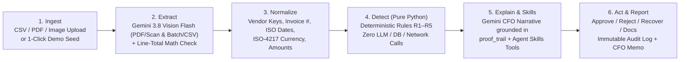

# Product Requirements Document (PRD) — LedgerLens

> **One-line pitch:** LedgerLens is a **pre-payment neuro-symbolic AI "money-leak auditor"** for mid-market finance teams ($20M–$500M annual supplier spend) and CA / audit firms—gating every weekly pay run to stop near-duplicate invoices, contract price drift, purchase-order (PO) overbilling, FX/tax errors, and cancelled-service charges before disbursement, backed by deterministic, line-level proof trails.

| Metadata | Value |
| :--- | :--- |
| **Product Name** | LedgerLens |
| **Document Scope** | Comprehensive Buildathon MVP (Current Baseline) + V1 Enterprise Roadmap |
| **Target Audience** | Engineering, AI/Product Teams, Buildathon Judges & Enterprise Stakeholders |
| **Event / Program** | Google DeepMind & Google Cloud Startup Buildathon India 2026 (Team Builders) |
| **Repository** | `naughtynova69/LedgerLens-project` |
| **Core Invariant** | **Gemini extracts and explains. Deterministic Python rules decide. Immutable workflow tables log. The LLM is never the judge.** |
| **Related Specs** | [01_PRODUCT_SPEC.md](file:///C:/LedgerLens/LedgerLens-project/docs/01_PRODUCT_SPEC.md) · [02_ARCHITECTURE.md](file:///C:/LedgerLens/LedgerLens-project/docs/02_ARCHITECTURE.md) · [03_DATA_MODEL.md](file:///C:/LedgerLens/LedgerLens-project/docs/03_DATA_MODEL.md) · [04_DETECTION_RULES.md](file:///C:/LedgerLens/LedgerLens-project/docs/04_DETECTION_RULES.md) · [05_API_SPEC.md](file:///C:/LedgerLens/LedgerLens-project/docs/05_API_SPEC.md) · [06_GEMINI_INTEGRATION.md](file:///C:/LedgerLens/LedgerLens-project/docs/06_GEMINI_INTEGRATION.md) · [DEMO_RUNBOOK.md](file:///C:/LedgerLens/LedgerLens-project/docs/DEMO_RUNBOOK.md) |

---

## 1. Executive Summary & Problem Statement

Mid-market finance teams lose **0.1%–0.35% of annual supplier spend** to near-duplicate invoices, contract overcharges, and cancelled-service renewals before every pay run—because manual AP checks can't scale, exact-match ERPs miss fuzzy errors, and CFOs won't act on black-box AI alerts without an audit-ready proof trail.

- **Target ICP:** Mid-market finance teams (**$20M–$500M** annual supplier spend) and **CA / audit firms** who export CSVs/PDFs today without heavy ERP integrations.
- **Exact Workflow Moment:** Primary **pre-payment gate before every weekly pay run**, paired with a **48-hour Historical Leak Diagnostic** (post-payment recovery) as the zero-ERP onboarding wedge.
- **Market Sizing:** Global AP automation is projected to grow from **$6.94B (2026)** to **$12.46B (2031)** at a **12.44% CAGR** (Mordor Intelligence), with the software-only segment at **$2.99B (2025)** (DataM Intelligence).

Three structural failure modes leave finance teams exposed:

| Structural Failure Mode | Quantified Reality | Why Existing Tools Fail |
| :--- | :--- | :--- |
| **1. Exact-Match ERP Blind Spots & Manual Cost** | Manual invoice processing averages **~$10 and 10+ days** per invoice (PRGX). | Non-identical invoice numbers (`INV-8821` vs. `INV-8821-R2`), altered dates, or vendor-name variants bypass rigid exact-match ERP duplicate checks, while contract price drift and cancelled renewals slip past manual reviews. |
| **2. The Black-Box AI Trust Deficit** | CFOs and AP controllers will not freeze vendor payouts on an opaque anomaly score. | Generic LLM wrappers flag *"this looks suspicious"* without deterministic math or line-level citations, causing finance teams to ignore alerts. |
| **3. Post-Payment Recovery vs. Pre-Payment Controls** | Post-payment recovery reclaims **~0.1% of spend** (**~$1M recovered per $1B spend** — PRGX); proactive pre-payment controls save **0.2%–0.35% per $1B spend** (Xelix / Duplo). | Post-disbursement clawbacks erode vendor goodwill and incur recovery fees. Leakage must be blocked **pre-payment before every weekly pay run** with an audit-ready proof trail. |

### Core Product Thesis (Neuro-Symbolic Architecture)

LedgerLens sits beside existing ERPs and AP workflows as a **pre-payment audit gate before every weekly pay run** (via zero-ERP CSV/PDF exports):
1. **Multimodal Extraction (`Gemini 3.8 Vision Flash`):** Unstructured PDFs/scans and structured CSVs (invoices, POs, contracts, vendor masters, payment ledgers) are parsed into strict Pydantic JSON schemas with deterministic arithmetic cross-checks.
2. **Deterministic Normalization & Rules Engine (`R1`–`R5`):** Pure Python stdlib rules—with **zero LLM imports, zero network calls, and zero database calls**—evaluate every normalized record and emit deterministic `amount_at_risk`, `confidence`, `recommended_action`, and `proof_trail` payloads.
3. **Explainable Narrative & Immutable Workflow:** Gemini translates the deterministic `proof_trail` into CFO-ready language without altering or recomputing any numbers. Every ingestion, extraction, detection, and reviewer decision writes an append-only `audit_log` row.

---

## 2. Product Goals, Non-Goals & Success Metrics

### 2.1 Goals
- **MVP (Current Buildathon Baseline):**
  - Provide an end-to-end **Upload/Seed → Extract → Normalize → Detect (R1–R5) → Explain → Decide → Audit Memo** pipeline runnable locally and deployable as a unified container on Google Cloud Run.
  - Detect **100% of the 6 planted anomalies** in `sample_data/` (**₹40,531.60** nominal exposure across `R1`–`R5`) with **0 false positives** across the 4 clean control invoices (`INV-9001`, `INV-9010`, `INV-9400`, `INV-9500`).
  - Operate gracefully offline/without a `GEMINI_API_KEY` via deterministic CSV extraction, regex-based mock PDF fallback, and proof-trail fallback narratives.
- **V1 Enterprise Product:**
  - Transition persistence and file storage from SQLite + local `uploads/` to **Cloud SQL** + **Google Cloud Storage (GCS)** with **Vertex AI** + **Secret Manager**.
  - Introduce live FX rate feeds, multi-tenant RBAC/SSO, ERP connectors/webhooks (SAP, NetSuite, Oracle, Zoho Books), automated scheduled batch sweeps, and interactive vendor/spend relationship exploration.

### 2.2 Explicit Non-Goals
- **Not a System of Record / Full ERP:** LedgerLens does not replace accounting ledgers or execute bank rails/autonomous payments.
- **No Black-Box Fraud Scoring:** No ML/LLM risk scores may trigger payment holds without deterministic field-level evidence and math.

### 2.3 Key Performance Indicators (KPIs)

| Metric | MVP Target (Verified Baseline) | V1 Enterprise Target |
| :--- | :--- | :--- |
| **Planted Anomaly Recall (`sample_data/`)** | **100%** (6/6 anomalies detected) | ≥98% recall on enterprise benchmark corpus |
| **Clean Control False-Positive Rate** | **0%** (0/4 control invoices flagged) | <2% false-positive rate per rule |
| **Evidence Trail Completeness** | **100%** of findings carry `proof_trail` + `evidence[]` | **100%** immutable evidence provenance |
| **Time-to-Findings (`sample_data/` flow)** | **< 2 minutes** end-to-end (1-click seed + detect < 2s) | < 30 seconds per 1,000-line batch |
| **Backend Automated Test Pass Rate** | **100%** (`33 passed` via `pytest`) | ≥95% line/branch coverage + CI gates |
| **Financial ROI Metric** | Tracks `Total Spend Audited`, `Total Money at Risk`, `Open Exceptions`, `Recovered / Blocked` | Net ₹/$ recovered vs. subscription cost (target >10× ROI) |

---

## 3. Target Users & Personas

| Persona | Primary Role in LedgerLens | Core Jobs-to-be-Done | Primary Views Used |
| :--- | :--- | :--- | :--- |
| **AP Analyst** | Daily exception triage and pre-payment gating | Upload batches, verify PDF extractions, review R1–R5 queue sorted by exposure, inspect 3-way diffs, hold/reject/request docs | `Upload & Batches`, `Proof Trail Explorer` (`FindingsView`) |
| **Finance Controller / CFO** | Executive oversight, payout sign-off, leadership reporting | Monitor spend exposure KPIs, review plain-English explanations, export CFO Audit Memo for leadership/board | `Dashboard`, `CFO Audit Memo` (`MemoView`) |
| **Procurement Lead** | Vendor rate governance and contract dispute resolution | Act on R2/R3/R5 disputes with exact contract clause & PO line references | `Proof Trail Explorer`, `CFO Audit Memo` |
| **Internal / External Auditor** | Compliance verification and audit trail inspection | Verify deterministic rule criteria, confirm human-in-the-loop attribution, inspect chronological logs | `Audit Log` (`AuditLogView`), `Rules Reference` (`RulesView`) |
| **Enterprise IT / SecOps *(V1)*** | Identity, ERP integration, and policy governance | Configure SSO/RBAC, Secret Manager/Vertex AI keys, Cloud SQL, ERP sync webhooks, custom tolerance thresholds | *V1 Admin Console / API* |

---

## 4. End-to-End Architecture & Neuro-Symbolic Invariants

### Non-Negotiable Architectural Invariants
1. **Pure Detection Core (`backend/app/detect/`):** Uses Python `stdlib` only (`backend/app/detect/types.py`, `backend/app/detect/registry.py`, `backend/app/detect/rules/*.py`). Must never import `google`, `genai`, `openai`, HTTP clients, or database drivers.
2. **Fail-Closed Extraction (`backend/app/extract/`):** If required fields (`invoice.number` or `grand_total` + lines) are missing, or if extracted `quantity * unit_price * (1 + tax_pct/100)` deviates from `line_total` by more than `0.05`, the record/batch is flagged `needs_review` rather than silently guessed.
3. **Narrator, Not Judge (`backend/app/explain/`):** Gemini receives only the deterministic `Finding` + `proof_trail` JSON and must cite record IDs and `proof_trail.math` values verbatim without recomputing totals.
4. **Immutable Auditability (`backend/schema.sql`):** Every batch ingest, extraction, detection run, and reviewer decision appends an immutable record to `audit_log` (and `decisions` for finding actions).

---

## 5. Functional Requirements

Requirements are tagged by release phase: **`[MVP]`** (implemented and verified in current repository) and **`[V1]`** (planned enterprise roadmap).

### 5.1 FR-1: Document Ingestion & Batch Management
- **`[MVP]` Multi-Kind Upload (`POST /api/ingest/upload`):** Supports `vendors`, `invoices`, `purchase_orders`, `contracts`, `payments`, and `payment_ledger` across `.csv`, `.pdf`, `.png`, `.jpg`, `.jpeg`.
- **`[MVP]` Fail-Closed CSV Header Validation (`backend/app/ingest/router.py`):** Validates required headers per kind (e.g., `invoices` requires `invoice_number`, `vendor_id`, `invoice_date`, `item`, `quantity`, `unit_price`, `currency`, `tax_pct`, `line_total`) and reports `problems[]` while persisting provenance under `UPLOAD_DIR` (`<batch_id>-<filename>`).
- **`[MVP]` 1-Click Demo Seed (`POST /api/seed/sample_data`):** Resets findings/decisions/audit logs, loads the 5 CSV files from `sample_data/`, creates a `DEMO-XXXX` batch, and runs `R1`–`R5` detection automatically.
- **`[MVP]` Batch Tracking (`GET /api/batches`, `GET /api/batches/{batch_id}`):** Tracks batch lifecycle states: `uploaded` → `ready` / `extracted` / `needs_review` → `detected`.
- **`[V1]` Enterprise Ingestion Connectors:** Direct Google Cloud Storage (GCS) bucket watch, SFTP/email AP inbox ingestion, and read-only ERP connectors/webhooks (SAP, NetSuite, Oracle, Zoho Books).

### 5.2 FR-2: Multimodal AI Extraction & Arithmetic Verification
- **`[MVP]` Model Tier Routing (`backend/app/extract/gemini_extract.py`):**
  - Routes single/complex documents (`invoices`, `contracts`, `purchase_orders` PDFs/images) to `GEMINI_PRIMARY_MODEL` (default `gemini-3.8-vision-flash`, `temperature=0`).
  - Routes batch loads and `text/csv` workloads to `GEMINI_FLASH_MODEL` (default `gemini-3.8-vision-flash`, `Gemini 3.8 Vision Flash`).
- **`[MVP]` Pydantic Structured Outputs (`backend/app/extract/schemas.py`):** Enforces `ExtractedInvoicePayload`, `ExtractedContractPayload`, and `ExtractedPOPayload` via `response_mime_type="application/json"` and `response_schema`.
- **`[MVP]` Deterministic Line-Total Cross-Check:** `verify_extracted_line_totals()` validates `round(qty * unit_price * (1 + tax_pct / 100), 2)` against `line_total` within `±0.05` tolerance and returns structured `verification_warnings[]`, transitioning batches with mismatches or missing required fields to `state="needs_review"`.
- **`[MVP]` Zero-Key Offline Fallback (`mode="mock_fallback"`):** When `GEMINI_API_KEY` is unset, regex key-value extraction populates the exact same Pydantic schemas so CI tests and offline demos operate seamlessly.
- **`[V1]` Extraction Quality & Scale:** Vertex AI Batch Prediction for >10k-page archives, human-in-the-loop side-by-side PDF bounding-box highlight verification, and an automated AI Studio extraction precision eval harness (`eval_gemini_extraction.py`).

### 5.3 FR-3: Deterministic Normalization
- **`[MVP]` Canonical Normalization (`backend/app/normalize/normalize.py`):**
  - `normalize_vendor_name()` / `canonical_vendor_key()`: Strips punctuation and trailing legal suffixes (`PVT`, `PRIVATE`, `LTD`, `LIMITED`, `LLP`, `INC`, `LLC`, `CO`, `COMPANY`, `CORP`, `CORPORATION`, `ENTERPRISES`, `TRADERS`) to lowercase canonical keys.
  - `normalize_invoice_number()`: Strips non-alphanumeric characters and uppercases (`INV-8821-R2` → `INV8821R2`).
  - `normalize_date()`: Converts 9 common date formats (`%Y-%m-%d`, `%d/%m/%Y`, `%d-%m-%Y`, `%d %b %Y`, etc.) to ISO-8601 `YYYY-MM-DD`.
  - `normalize_currency()` & `normalize_amount()`: Maps currency symbols (`₹`, `Rs.`, `$`, `US$`, `€`, `£`) to ISO-4217 codes and parses formatted strings (`Rs. 4,956.00`) to 2-dp floats.
- **`[V1]` Live FX & Fuzzy Entity Resolution:** Replace static `REFERENCE_FX_RATES` (`INR=1.0`, `USD=88.0`, `EUR=95.0`, `GBP=112.0`) with daily ECB/RBI FX API rates cached by invoice/payment date, plus SKU/item synonym dictionaries per enterprise tenant.

### 5.4 FR-4: Pure Deterministic Detection Engine (`R1`–`R5`)

Every rule in `backend/app/detect/rules/` returns `Finding` objects containing `rule_id`, `title`, `severity`, `amount_at_risk`, `currency`, `entity_refs`, `evidence[]`, `summary`, `confidence`, `recommended_action` (`HOLD_PAYMENT` | `REQUEST_CREDIT_NOTE` | `DISPUTE_VENDOR` | `CANCEL_AUTOPAY`), and `proof_trail` (including `proof_trail.math`).

| Rule ID | Rule Name | Trigger Conditions & Deterministic Logic | False-Positive Guards | Severity & Action |
| :--- | :--- | :--- | :--- | :--- |
| **`R1`** | **Duplicate & Near-Duplicate Invoices** (`duplicate.py`) | Groups by `vendor_id`. Flags pairs `(A, B)` when `amount_drift <= 0.5%`, `line_similarity (Jaccard) >= 0.8`, AND (`num_similarity >= 0.6` via `SequenceMatcher` on raw/alphanumeric-canonical number OR `date_gap <= 30 days`); OR same `(po_id, item, qty)` double-billed with `amount_drift <= 0.5%` & `line_sim >= 0.8`. | Skips pairs if either invoice has `status == "credited"` (legitimate credit revision) or `grand_total <= 0`. | `critical` + `REQUEST_CREDIT_NOTE` if both paid; `high` + `HOLD_PAYMENT` otherwise. |
| **`R2`** | **Contract Price Leakage** (`contract_price.py`) | Joins invoice line to `active` contract on `(vendor_id, normalized item)` within `start_date`..`end_date`. Flags when `unit_price > contracted_unit_price` (applying `discount_pct` when `discount_applied_pct` is present). `amount_at_risk = (unit_price - governed_rate) * qty * (1 + tax_pct/100)`. **Contract governs even if PO carries wrong price.** | Exact normalized item match only; skips inactive/expired contracts (handled by `R5`) and items without a contract (handled by `R3`). | `critical` + `REQUEST_CREDIT_NOTE` if paid; `high` + `DISPUTE_VENDOR` if unpaid. |
| **`R3`** | **PO Mismatch & Overbilling** (`po_mismatch.py`) | 1) **Cumulative Quantity Overbilling:** Sums `quantity` per `(po_id, item)` across unique (non-duplicate) invoice lines; flags if `sum > po.quantity`. `amount_at_risk = excess * po.unit_price * (1 + tax_pct/100)`. 2) **Premature Billing:** Flags if `invoice_date < po.expected_delivery` when PO is not `delivered`/`received`/`closed`. 3) **Unordered Item:** Flags if item is absent from referenced non-cancelled PO. | Sums partial deliveries before comparing; deduplicates `R1` resubmissions prior to summing qty; skips `cancelled` POs (`R5`). | `high` + `HOLD_PAYMENT` (qty overbilling); `high` + `DISPUTE_VENDOR` (unordered item); `medium` + `HOLD_PAYMENT` (premature billing). |
| **`R4`** | **Currency & Tax Errors** (`currency_tax.py`) | 1) **Currency Mismatch:** Compares `invoice.currency` against `PO -> Contract -> Vendor.default_currency` precedence. 2) **Tax Overcharge:** Flags `invoice.tax_pct > contract.tax_pct` (e.g., GST on tax-exempt contract line); `amount_at_risk = qty * unit_price * (tax_delta / 100)`. 3) **Duplicate Tax Line:** Flags `>= 2` taxed lines for same `(invoice_number, item)`. 4) **FX Rate Anomaly:** Flags `payments.fx_rate_to_inr` deviating `> 2%` (`MAX_FX_DRIFT = 0.02`) from `REFERENCE_FX_RATES`. | Currency precedence avoids cascading duplicates; tax check runs only when contract defines expected `tax_pct`. | `high` + `DISPUTE_VENDOR` (currency/tax); `high` + `REQUEST_CREDIT_NOTE` (FX drift on settled payment). |
| **`R5`** | **Cancelled-Service Leakage** (`cancelled_service.py`) | 1) **Contract Cancelled / Expired:** Flags invoice line matching `(vendor_id, item)` where `contract.status` ∈ `{cancelled, terminated, inactive, suspended}` or `invoice_date > contract.end_date`. 2) **Terminated Vendor:** Flags invoices from vendors with `status` ∈ `{cancelled, terminated, inactive, suspended}`. 3) **Cancelled PO:** Flags invoices referencing `cancelled`/`terminated` POs. | Deduplicates per `(invoice_number, line_no, reason)` so one line does not emit redundant findings for the same contract/vendor/PO. | `critical` if `paid`, `high` if unpaid; `CANCEL_AUTOPAY`. |

- **`[V1]` Configurable Rule Engine & Additional Rules:** Per-tenant threshold configuration (`MAX_DATE_GAP_DAYS`, `MAX_FX_DRIFT`, `MAX_AMOUNT_DRIFT`), multi-currency FX-normalized rollup KPIs, plus `R6` (Split-PO / Approval-Limit Bypass) and `R7` (3-Way Goods Receipt / GRN Mismatch).

### 5.5 FR-5: Explainability & Google Agent Skills
- **`[MVP]` CFO-Ready Narrative (`backend/app/explain/gemini_explain.py`):**
  - Live mode calls `GEMINI_PRIMARY_MODEL` (`temperature=0.2`) with `EXPLANATION_SCHEMA` returning `{headline, explanation, recommended_action, limitations, confidence_label}` plus attribution metadata (`decision_engine="Deterministic Rule R[X]"`, `model_used`).
  - Fallback mode (`fallback_without_gemini()`) renders deterministic narratives strictly from `proof_trail` with `generated_without_gemini=True`.
- **`[MVP]` Google Agent Skills / Function Calling (`backend/app/skills/agent_tools.py`):**
  - `GET /api/skills` exposes `GEMINI_TOOL_DECLARATIONS` and `POST /api/skills/{tool_name}` executes:
    1. `fetch_payment_records(vendor_id, invoice_number)` — queries `payments` joined with `invoices`.
    2. `generate_audit_memo(batch_id)` — returns deterministic Markdown + structured JSON CFO memo.
    3. `route_recovery_task(finding_id, assignee, note)` — routes finding to `recovery` status and writes `decisions` + `audit_log`.
- **`[V1]` Autonomous Orchestration & Conversational Copilot:** Allow Gemini function-calling agents to answer natural-language CFO queries over verified findings, draft vendor dispute emails/credit-note requests, and push recovery tickets to Jira/ServiceNow/Slack.

### 5.6 FR-6: Exception Dashboard, Split-View Proof Trail Explorer & Audit Workflow
- **`[MVP]` Frontend Application (`frontend/src/` — React 19, Vite 6, Tailwind CSS 3.4, Lucide):**
  - Institutional fintech aesthetic (`#F8FAFC` canvas, tabular monospace numerals, semantic badges: Crimson `#DC2626` for Critical/R1/R5, Amber `#D97706` for Medium/R2/R3, Indigo `#4F46E5` for R4/FX, Emerald `#059669` for Verified/Recovered).
  - **6 Primary Views:**
    1. **Dashboard (`DashboardView.jsx`):** Pre-payment hero strip, 4 KPI cards (`Total Spend Audited`, `Total Money at Risk`, `Open Exceptions`, `Recovered / Blocked`), top findings preview, and R1–R5 rule coverage summary.
    2. **Proof Trail Explorer (`FindingsView.jsx` + `ProofTrailInspector.jsx`):** Searchable/filterable queue (by Rule, Severity, Status, text search; sorted by `amount_at_risk DESC`) paired with a split-view inspector showing:
       - Attribution badge: `Decision: Deterministic Rule R[X] · Narrative: Gemini 3.8 Vision Flash`
       - CFO-Ready Explanation card
       - 3-Way Evidence Diff Card (Invoice Line vs. Contract Clause vs. PO Line + Linked Payments + `proof_trail.math`)
       - Reviewer Action Bar (`approve`, `reject`, `recovery`, `request_docs`) requiring an audit note + reviewer name
    3. **Upload & Batches (`UploadView.jsx` + `UploadModal.jsx`):** Drag-and-drop CSV/PDF upload, 1-click Demo Seed, global detection trigger, and batch status table.
    4. **CFO Audit Memo (`MemoView.jsx`):** Deterministic Markdown + structured JSON summary with one-click Copy Markdown and Download `.md`.
    5. **Rules Reference (`RulesView.jsx`):** Transparent documentation of `R1`–`R5` thresholds and guards.
    6. **Audit Log (`AuditLogView.jsx`):** Chronological append-only trail of `ingest`, `extract`, `detect`, and reviewer decisions with click-through to findings.
- **`[V1]` Enterprise UX Additions:** Interactive **Graphify / Entity-Relationship Spend Graph** visualizing vendor-contract-PO-invoice clusters (e.g., shell vendor networks and split invoices), multi-user approval queues, and currency-converted executive rollups.

---

## 6. Data Model & API Contract Summary

### 6.1 Relational Schema (`backend/schema.sql`)
9 SQLite tables (driver-portable to PostgreSQL / Cloud SQL):
- **Core ERP Entities:** `vendors`, `contracts` (PK: `(contract_id, item)`), `purchase_orders` (PK: `(po_id, po_line)`), `invoices` (1 row per line, PK: `(invoice_number, line_no)`), `payments`.
- **Pipeline & Audit Tables:** `batches` (`batch_id`, `kind`, `stored_path`, `rows_detected`, `state`, `created_at`), `findings` (includes `entity_refs`, `evidence`, `explanation`, `recommended_action`, `proof_trail` JSON columns), `decisions` (`id`, `finding_id`, `action`, `reviewer`, `note`, `created_at`), `audit_log` (`id`, `ts`, `actor`, `action`, `object_type`, `object_id`, `detail`).

### 6.2 Implemented REST API Surface (`backend/app/main.py`)

| Endpoint | Method | Purpose |
| :--- | :--- | :--- |
| `/health` | `GET` | Liveness check (`{"status": "ok", "version": "0.1.0"}`) |
| `/api/stats` | `GET` | Dashboard KPIs (`total_findings`, `total_at_risk`, `open_at_risk`, `recovered_amount`, `total_audited_spend`, `by_severity`, `by_rule`, `by_status`, `batches_count`) |
| `/api/batches` & `/api/batches/{batch_id}` | `GET` | List batches or inspect single batch state |
| `/api/ingest/upload` | `POST` | Multipart CSV/PDF/image upload + header validation + batch registration |
| `/api/seed/sample_data` | `POST` | 1-click load `sample_data/*.csv` + run `R1`–`R5` |
| `/api/run/{batch_id}/extract` | `POST` | Run Gemini/CSV extraction + arithmetic cross-checks |
| `/api/run/{batch_id}/detect` | `POST` | Run deterministic `R1`–`R5` + explanation layer for batch |
| `/api/run-detection` | `POST` | Trigger full `R1`–`R5` detection across current DB |
| `/api/findings` | `GET` | Filterable exception queue (`?status=&severity=&rule_id=`), ordered by `amount_at_risk DESC` |
| `/api/findings/{finding_id}` | `GET` | Full finding detail + joined `source_records` + `decisions` |
| `/api/findings/{finding_id}/decision` | `POST` | Record `approve` / `reject` / `request_docs` / `recovery` + append `audit_log` |
| `/api/memo` | `GET` | Structured JSON + Markdown CFO Audit Memo |
| `/api/audit-log` | `GET` | Latest 100 immutable audit events |
| `/api/skills` & `/api/skills/{tool_name}` | `GET` / `POST` | List and invoke Google Agent Skills (`fetch_payment_records`, `generate_audit_memo`, `route_recovery_task`) |

---

## 7. Non-Functional Requirements, Security & Deployment

| Category | MVP Specification (Implemented) | V1 Enterprise Requirement |
| :--- | :--- | :--- |
| **Determinism & Auditability** | Idempotent finding upsert by `(rule_id, entity_refs)`; pure `detect/` stdlib code; append-only `audit_log` & `decisions`. | Cryptographic hash-chaining of `audit_log` rows; WORM archival export. |
| **Secrets & Key Hygiene** | `.env` excluded via `.gitignore`; `GEMINI_API_KEY` read via env (`backend/app/config.py`). | Google Secret Manager (`GEMINI_API_KEY=GEMINI_API_KEY:latest`), Workload Identity Federation, zero static credentials. |
| **Containerization & Cloud Run** | Multi-stage `Dockerfile` (Node 22 builds `frontend/dist` → Python 3.12 `uvicorn` serves FastAPI + SPA on `$PORT=8080`). | Auto-scaling Cloud Run (`asia-south1`), Cloud Build CI/CD (`cloudbuild.yaml`), `deploy/cloudrun.sh`. |
| **Persistence & Storage** | SQLite (`DB_PATH`) + local filesystem (`UPLOAD_DIR`). | Cloud SQL (PostgreSQL) + Cloud Storage (`GCS_UPLOAD_BUCKET`) with CMEK encryption. |
| **Authentication & Access** | Single demo workstation (`--allow-unauthenticated` for Buildathon demo). | OAuth2 / OIDC SSO, multi-tenant row-level isolation, RBAC (Analyst vs. Controller vs. Auditor). |

---

## 8. Acceptance Criteria & Sample Dataset Verification

Running `POST /api/seed/sample_data` (or `pytest` in `backend/`) MUST produce **exactly 6 findings** totaling **₹40,531.60** nominal exposure and **0 false positives** on the 4 clean control invoices (`INV-9001`, `INV-9010`, `INV-9400`, `INV-9500`):

| Expected Anomaly | Rule | Case Description (`sample_data/`) | Severity | Exposure |
| :--- | :--- | :--- | :--- | :--- |
| **1** | `R1` | `INV-8821` vs `INV-8821-R2` — Sunbeam Electricals, ₹4,956.00 each, 2-day gap, both paid (`PAY-5001`, `PAY-5002`) | `critical` | `₹4,956.00` |
| **2** | `R2` | `INV-9102` — LED Panel billed @ ₹465.00 vs Contract `C-001` @ ₹420.00 across 6 units + 18% GST (`PO-1006` also wrong; contract governs) | `high` | `₹318.60` |
| **3** | `R3` | `INV-9155` — A4 Paper Box billed 60 units vs `PO-1008` limit 50 units (10 units excess) | `high` | `₹2,832.00` |
| **4** | `R4` | `INV-9201` — Hex Bolt billed in `EUR` against `PO-1003` authorized in `USD` | `high` | `€225.00` (`225.00`) |
| **5** | `R4` | `INV-9301` — Export Freight billed 18% GST vs Contract `C-004` (`tax_pct = 0`, exempt) | `high` | `₹2,700.00` |
| **6** | `R5` | `INV-9250` — CloudSuite Monthly ₹29,500.00 paid 2026-10-10 after Contract `C-005` cancelled effective 2026-09-30 | `critical` | `₹29,500.00` |

**Verified Engineering Baseline:**
- Backend test suite: `33 passed` (`backend/.venv/Scripts/python.exe -m pytest backend/tests -q`).
- Frontend production build: React 19 + Vite 6 + Tailwind CSS 3.4 served via FastAPI SPA mount or Vite dev server.

---

## 9. Phased Roadmap & Business Model

### 9.1 Product Roadmap

| Phase | Milestone | Key Deliverables |
| :--- | :--- | :--- |
| **Phase 0: Buildathon MVP *(Current)*** | Explainable Pre-Payment Gate | FastAPI + SQLite + `R1`–`R5` + Gemini 3.8 Vision Flash extraction & explanation + Agent Skills + React Split-View Proof Trail Explorer + Cloud Run container & Demo Runbook. |
| **Phase 1: Design Partner Pilot** | Cloud Production & Eval Harness | Cloud SQL + GCS migration, Vertex AI + Secret Manager, live FX rate API, AI Studio schema export + `eval_gemini_extraction.py` precision benchmark, PDF bounding-box highlights. |
| **Phase 2: Enterprise Scale** | ERP Connectors & Spend Graph | Read-only SAP/NetSuite/Oracle connectors, multi-tenant RBAC/SSO, custom policy engine (`R6` split-PO, `R7` GRN 3-way match), **Graphify** vendor/entity risk network graph, Slack/Jira recovery routing. |

### 9.2 Business Model & GTM Strategy (Hybrid Wedge → SaaS)
- **Target ICP & Market Context:** Mid-market finance teams (**$20M–$500M** annual supplier spend) and **CA / audit firms** exporting CSVs/PDFs today without heavy ERP integrations. Global AP automation grows from **$6.94B (2026)** to **$12.46B (2031)** at a **12.44% CAGR** (Mordor Intelligence), with software-only spend at **$2.99B (2025)** (DataM Intelligence).
- **Hybrid Wedge → SaaS Motion:**
  1. **Land — 48-Hour "Historical Leak Diagnostic":** Free diagnostic or **15%–20% contingency** on 6–12 months of exported CSVs/PDFs (zero ERP integration required), proving **$50k–$250k** in historical leaks and near-miss errors.
  2. **Expand — Recurring Pre-Payment SaaS:** Embedded as the primary pre-payment gate before every weekly pay run across three tiers—**Starter** (`<=2,500` invoices/mo), **Growth** (`<=10,000` invoices/mo), and **Enterprise** (custom)—achieving **85%–92%+ gross margins** using **Gemini 3.8 Vision Flash** paired with zero-cost deterministic Python rules (`R1`–`R5`).
  3. **Distribute — CA / Audit Firms:** Multi-tenant workspace priced per client audit, enabling accounting and audit firms to standardize pre-payment and diagnostic audits across their client portfolios.
