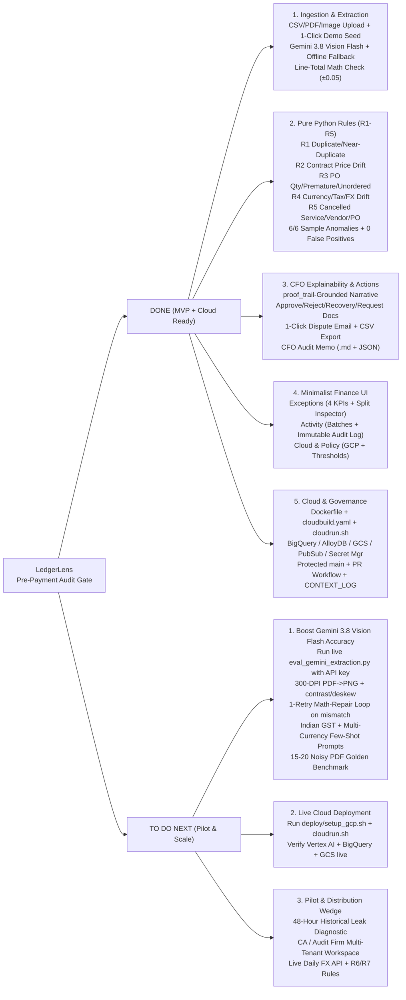

# LedgerLens — Project Mind Map & Accuracy Roadmap

> **Plain-English Summary:** LedgerLens is a **pre-payment audit gate** for mid-market finance teams (`$20M–$500M` supplier spend) and CA/audit firms. You upload exported CSVs or PDF/image invoices, **Gemini 3.8 Vision Flash** extracts structured fields, **pure Python rules (`R1`–`R5`)** catch duplicates/overcharges/tax/cancelled-service leaks with deterministic math, and **Gemini 3.8 Vision Flash** turns that proof into a CFO-ready explanation before money leaves the bank.

---

## 1. Visual Mind Map: What Is Done vs. What Is Next

---

## 2. How to Increase `Gemini 3.8 Vision Flash` Vision & Extraction Accuracy

Because LedgerLens already has `verify_extracted_line_totals()` (`backend/app/extract/gemini_extract.py`) and `backend/tests/eval_gemini_extraction.py`, you can improve vision accuracy systematically:

1. **Measure First with Live Eval (`eval_gemini_extraction.py`):**
   - Set `GEMINI_API_KEY` in `backend/.env` and run `pytest backend/tests/eval_gemini_extraction.py` to get a real baseline score instead of guessing.
2. **Pre-Process PDFs & Scans Before Sending to Vision:**
   - Render PDFs at `250–300 DPI` PNGs, auto-rotate/deskew crooked scans, and apply light contrast sharpening for faded thermal/scanned bills before calling `gemini-3.8-vision-flash`.
3. **Add a 1-Retry Deterministic Self-Correction Loop:**
   - Today, `verify_extracted_line_totals()` flags mismatches (`qty * unit_price * (1 + tax_pct/100) != line_total`) as `needs_review`.
   - Upgrade: when a line fails the math check, automatically send **one targeted repair call** back to `gemini-3.8-vision-flash` with the exact discrepancy (`"Extracted qty=6, unit_price=465, tax=18%, total=3100 — re-read line 1 carefully"`), and only fall back to `needs_review` if the second pass still fails.
4. **Indian GST & Multi-Currency Few-Shot Grounding:**
   - Keep `temperature=0` + `response_schema`, and add 2–3 compact examples in the extraction prompt showing `CGST + SGST = 18%` vs `IGST`, `₹ / Rs. / INR`, `€ / EUR`, `$ / USD`, and `PO-XXXX` references so line tax and currency fields never drift.
5. **Build a 15–20 Document Golden Test Set:**
   - Collect tricky real-world invoices (multi-page PDFs, stamped/handwritten totals, multi-tax tables, foreign currency) in `sample_data/eval_pdfs/` and score field-level F1 (`invoice_number`, `vendor_name`, `currency`, `tax_pct`, `line_total`) on every prompt or preprocessing change.
